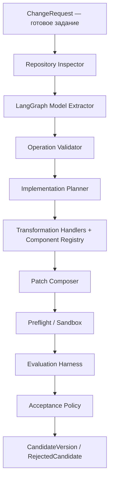

# Кодовый оптимизатор агента

## 1. Назначение и границы ответственности

Кодовый оптимизатор — модуль, который получает формализованное задание на изменение целевого агента и переводит это задание в конкретный, проверяемый patch репозитория. Его задача — не решать, какая архитектура агента должна быть выбрана, а корректно реализовать уже заданное изменение в исходном коде, связать его с существующей LangGraph-конфигурацией, обновить зависимые части и доказать работоспособность через тесты и повторную оценку агента.

Для LangGraph основная зона ответственности — программная реализация заранее разрешённых операций над графом: добавление узла известного типа, вставка узла между существующими узлами, добавление или изменение заранее допустимой связи, conditional edge, замена реализации узла, обновление State, imports, configuration и wiring. Кроме этого, модуль может выполнять локальные code-level исправления, если проблема относится к реализации: retry, timeout, parser, tool wrapper, validation, serialization, state handling, caching, recovery или аналогичная логика.

Модуль не придумывает новую топологию графа и не принимает архитектурных решений. Если изменение затрагивает nodes/edges, на вход приходит готовый StructuralChangePlan. Для кодового оптимизатора это внешний контракт; происхождение этого плана находится вне области данной спецификации.

## 2. Что приходит на вход и что модуль обязан вернуть

| Объект               | Содержание                                                                                                                             |
|----------------------|----------------------------------------------------------------------------------------------------------------------------------------|
| ChangeRequest        | Единый входной объект. Содержит type=STRUCTURAL_CHANGE или type=IMPLEMENTATION_REPAIR, target_version, ограничения, критерии проверки. |
| StructuralChangePlan | Готовое формализованное задание: operation, node_type, anchors, edge_type, parameters, allowed_paths. Модуль только исполняет его.     |
| ImplementationIssue  | Локальная проблема реализации с evidence: failing task, trace fragment, suspected files, expected behavior.                            |
| TargetDescriptor     | Framework, repository root, graph entrypoints, build/test commands, plugin/runtime metadata.                                           |
| CandidateVersion     | Новая версия репозитория с parent_id, commit/worktree id, patch, manifest и результатами проверок.                                     |
| ImplementationReport | Что изменено, какие файлы затронуты, какие проверки выполнены, результат benchmark comparison и решение accept/reject.                 |

```python
class ChangeRequest(BaseModel):
    request_id: str
    request_type: Literal["STRUCTURAL_CHANGE", "IMPLEMENTATION_REPAIR"]
    target_version: str
    structural_change: StructuralChangePlan | None = None
    implementation_issue: ImplementationIssue | None = None
    constraints: ChangeConstraints
    acceptance: AcceptanceCriteria

class StructuralChangePlan(BaseModel):
    operation: StructuralOperation
    node_type: str | None
    source_node: str | None
    target_node: str | None
    parameters: dict[str, Any]
    allowed_paths: list[str]
```


## 3. Общий pipeline кодового оптимизатора





*Рисунок 1. Архитектура кодового оптимизатора*

После получения ChangeRequest модуль сначала исследует репозиторий и строит локальную модель текущей реализации: где создаётся StateGraph, где регистрируются nodes, где задаются edges и conditional edges, как устроен State, какие функции являются node implementations и какие tests уже существуют. Затем входное изменение валидируется относительно фактического графа и разрешённого каталога операций. Только после этого строится ImplementationPlan — точный список файлов и действий, которые необходимо выполнить.

ImplementationPlan передаётся набору transformation handlers. Для простых операций handler может выполнить детерминированное преобразование сам. Если необходимо написать содержимое новой функции node или адаптировать существующий код, handler формирует строго ограниченный контекст для coding LLM. Результатом всегда является PatchSet, а не произвольная изменённая рабочая копия. PatchSet применяется в отдельном Git worktree, проходит статические проверки, unit/integration tests, сборку и затем полноценный запуск target agent через Evaluation Harness. Только после сравнения с parent версия может быть принята.

```mermaid
flowchart LR
    A["StructuralChangePlan"] --> B["Validate operation"] --> C["Locate graph and affected files"] --> D["Select handler"]
    D --> E["Generate / instantiate node code"] --> F["Update edges, state, imports, config"] --> G["Compose diff"]
    G --> H["Static checks and unit tests"] --> I["Run candidate on benchmark"] --> J["Accept / reject"]
```





*Рисунок 2. Исполнение готового изменения LangGraph*

## 4. Каталог разрешённых LangGraph-преобразований

Каталог операций — центральный механизм контроля. Кодовый оптимизатор не получает право свободно перестраивать граф. Он реализует только операции, для которых существует зарегистрированный handler и формальная схема параметров.

| Операция             | Что делает кодовый оптимизатор                                                                                                             | Основные проверки                                                                       |
|----------------------|--------------------------------------------------------------------------------------------------------------------------------------------|-----------------------------------------------------------------------------------------|
| ADD_NODE             | Создаёт реализацию узла выбранного зарегистрированного типа, добавляет graph.add_node, imports/config и при необходимости расширяет State. | Имя уникально; node_type зарегистрирован; callable совместим со State.                  |
| INSERT_NODE          | Вставляет новый узел между двумя существующими anchor nodes; заменяет прямую связь на две связи.                                           | Оба anchor существуют; исходная связь существует; операция не создаёт запрещённый цикл. |
| ADD_EDGE             | Добавляет заранее допустимое ребро между существующими nodes.                                                                              | Nodes существуют; edge разрешён; нет дубликата.                                         |
| ADD_CONDITIONAL_EDGE | Подключает routing function и mapping ветвей.                                                                                              | Router существует/создаётся; все destinations валидны; return values покрыты.           |
| REMOVE_EDGE          | Удаляет конкретное ребро.                                                                                                                  | Ребро существует; после удаления граф остаётся валидным по заданным constraints.        |
| REPLACE_NODE_IMPL    | Заменяет callable существующего node без изменения его identity в графе.                                                                   | Signature/State contract сохранены; tests обновлены.                                    |
| UPDATE_NODE_CONFIG   | Меняет зарегистрированные параметры узла или tool binding.                                                                                 | Разрешённые keys; schema validation.                                                    |
| UPDATE_STATE_SCHEMA  | Добавляет/изменяет поля State, необходимые для уже заданной операции.                                                                      | Совместимость readers/writers; defaults; serialization.                                 |

## 5. Подробное описание модулей

### 5.1 ChangeRequest Gateway

Расположение: interfaces/api/change_requests.py

Ответственность. Принимает только валидный формализованный запрос и переводит его во внутреннюю команду use case.

Входы. ChangeRequest, authentication/context при API-варианте.

Алгоритм работы. Проверяет discriminator request_type, наличие соответствующего payload, версию target и ограничения. Не интерпретирует смысл структурного решения.

Выходы. ValidatedChangeCommand.

Зависимости. Pydantic schemas, application command bus.

Ошибки и rollback. Невалидная схема отклоняется до доступа к репозиторию.

Что тестировать. Schema validation, неверный discriminator, отсутствующий payload.

### 5.2 Repository Inspector

Расположение: application/services/repository_inspector.py

Ответственность. Строит индекс релевантной части репозитория и находит LangGraph entrypoints.

Входы. Repository path, TargetDescriptor.

Алгоритм работы. Сканирует конфиги и Python AST; ищет StateGraph/Graph constructors, add_node/add_edge/add_conditional_edges, State schema, node callables, tool registries и tests; возвращает ссылки file:line и symbol ids.

Выходы. RepositoryModel.

Зависимости. File system port, Python AST parser, optional tree-sitter.

Ошибки и rollback. Не изменяет файлы; при неоднозначных graph entrypoints возвращает explicit ambiguity error.

Что тестировать. Несколько графов, alias imports, factory functions, динамическая регистрация.

### 5.3 LangGraph Model Extractor

Расположение: application/services/langgraph_model_extractor.py

Ответственность. Нормализует найденный код в внутреннюю модель графа, удобную для проверки операций.

Входы. RepositoryModel.

Алгоритм работы. Формирует GraphModel(nodes, edges, conditional_edges, state_schema, entrypoint, finishpoints). Для каждого node хранит symbol, file, callable, reads/writes state и metadata.

Выходы. GraphModel.

Зависимости. Repository Inspector.

Ошибки и rollback. Если граф нельзя восстановить статически, допускается controlled introspection в sandbox; результат помечается source=runtime.

Что тестировать. Корректность node/edge map и round-trip на fixture-проектах.

### 5.4 Operation Validator

Расположение: domain/services/operation_validator.py

Ответственность. Проверяет, что входная операция разрешена и применима к текущему графу.

Входы. StructuralChangePlan или ImplementationIssue, GraphModel, ChangeConstraints.

Алгоритм работы. Выбирает schema операции, проверяет required fields, existence anchors, зарегистрированный node_type, allowed_paths, edge constraints, state constraints и scope. Возвращает ValidationResult и normalized operation.

Выходы. ValidatedOperation.

Зависимости. Domain registry/policies only.

Ошибки и rollback. Ничего не исправляет автоматически при смысловой неоднозначности; возвращает deterministic rejection reason.

Что тестировать. Каждая операция: positive/negative cases, forbidden paths, nonexistent anchors.

### 5.5 Implementation Planner

Расположение: application/services/implementation_planner.py

Ответственность. Преобразует validated operation в детерминированный план изменения файлов.

Входы. ValidatedOperation, RepositoryModel, GraphModel.

Алгоритм работы. Определяет handler, affected symbols/files, required node template, изменения State/imports/config/tests, порядок применения шагов и критерии postconditions.

Выходы. ImplementationPlan со списком ImplementationStep.

Зависимости. Handler registry, component registry.

Ошибки и rollback. План не содержит raw shell/LLM instructions; при нехватке информации останавливается до модификации.

Что тестировать. Для fixtures ожидаемый список файлов и steps должен быть стабильным.

### 5.6 Component Registry

Расположение: domain/registries/components.py

Ответственность. Хранит заранее допустимые типы узлов и их contracts.

Входы. Registry configuration.

Алгоритм работы. Для каждого node_type задаёт template/provider, expected inputs/outputs, required State fields, config schema, allowed placement rules и test factory.

Выходы. NodeComponentSpec.

Зависимости. Никаких внешних зависимостей.

Ошибки и rollback. Неизвестный node_type всегда запрещён до регистрации.

Что тестировать. Schema registry, duplicate ids, compatibility rules.

### 5.7 Transformation Handler Registry

Расположение: transformations/registry.py

Ответственность. Связывает StructuralOperation с конкретным исполнителем.

Входы. ValidatedOperation.

Алгоритм работы. Возвращает handler строго по operation id. Handler не выбирает новую операцию; он реализует уже выбранную.

Выходы. TransformationHandler.

Зависимости. Domain operation enum.

Ошибки и rollback. Нет handler — запрос отклоняется как unsupported.

Что тестировать. Полнота enum→handler mapping.

### 5.8 LangGraph Transformation Handlers

Расположение: transformations/langgraph/\*

Ответственность. Реализуют конкретные изменения add/insert node, edges, router, state и node implementation.

Входы. ImplementationPlan, RepositoryModel, GraphModel, ComponentSpec.

Алгоритм работы. Работают через AST/CST edits там, где возможно; для нового node создают файл/функцию из template, затем обновляют graph builder, imports, State и tests. При необходимости вызывают CodeModelPort только для тела функции в рамках заданного contract.

Выходы. ChangeFragments.

Зависимости. libcst/ast, Component Registry, CodeModelPort.

Ошибки и rollback. Каждый fragment должен быть идемпотентен; ошибка любого шага откатывает worktree.

Что тестировать. Golden tests на fixture repositories и повторное применение операции.

### 5.9 CodeModelPort

Расположение: application/ports/code_model.py

Ответственность. Генерирует только те фрагменты кода, которые нельзя получить детерминированным handler-ом.

Входы. CodeGenerationTask с contract, local context, tests и запретами.

Алгоритм работы. Получает минимальный context, возвращает structured CodeFragment/UnifiedDiff; не имеет прямого доступа к Git или shell.

Выходы. CodeFragment.

Зависимости. LLM adapter в infrastructure/llm.

Ошибки и rollback. Malformed output, scope escape или изменение несвязанных файлов отклоняется Patch Guard.

Что тестировать. Mock model, invalid diff, forbidden import, signature preservation.

### 5.10 Patch Composer

Расположение: application/services/patch_composer.py

Ответственность. Объединяет все ChangeFragments в один PatchSet и проверяет непротиворечивость.

Входы. ChangeFragments, base revision.

Алгоритм работы. Сортирует edits, разрешает imports, проверяет overlapping hunks, вычисляет touched files, формирует unified diff и manifest.

Выходы. PatchSet.

Зависимости. CST edit utilities.

Ошибки и rollback. Overlap/conflict → fail before application.

Что тестировать. Deterministic diff, conflict detection.

### 5.11 Workspace Manager

Расположение: application/ports/workspace.py + infrastructure/git/worktree.py

Ответственность. Изолированно применяет patch к candidate workspace.

Входы. Base revision, PatchSet.

Алгоритм работы. Создаёт git worktree/temporary clone, применяет patch, фиксирует candidate revision и предоставляет path sandbox-у.

Выходы. CandidateWorkspace.

Зависимости. Git.

Ошибки и rollback. При любой ошибке worktree уничтожается; main branch не изменяется.

Что тестировать. Apply/revert, concurrent worktrees, dirty repository handling.

### 5.12 Preflight Pipeline

Расположение: application/services/preflight.py

Ответственность. Отбрасывает технически некорректные кандидаты до дорогого benchmark run.

Входы. CandidateWorkspace, TargetDescriptor.

Алгоритм работы. Запускает formatting/lint, type checks, import checks, unit tests, graph compilation/smoke run, build/package. Для IDE-plugin target — extension build и запуск test host.

Выходы. PreflightReport.

Зависимости. SandboxPort, build adapter.

Ошибки и rollback. Timeout/resource violation → candidate rejected.

Что тестировать. Failing tests, graph compile error, packaging error, timeout.

### 5.13 Evaluation Harness

Расположение: application/services/evaluation_harness.py

Ответственность. Проверяет реальное поведение candidate и parent на одинаковых benchmark tasks.

Входы. AgentVersion, BenchmarkAdapter, TargetAgentAdapter, Evaluator.

Алгоритм работы. Подготавливает версию, запускает tasks, собирает AgentRun/trace, вызывает Evaluator, агрегирует score и guardrails.

Выходы. EvaluationReport.

Зависимости. Target adapter, benchmark, evaluator, trace store.

Ошибки и rollback. Одинаковые seeds/timeouts для сравниваемых версий; crashes отражаются в result, а не теряются.

Что тестировать. Determinism, timeout, partial failure, trace completeness.

### 5.14 Acceptance Policy

Расположение: domain/policies/acceptance.py

Ответственность. Решает, прошла ли реализация заданные критерии.

Входы. Parent report, candidate report, PreflightReport, AcceptanceCriteria.

Алгоритм работы. Проверяет primary metric, regression guardrails, crash rate, cost/latency budgets и обязательные task-level constraints.

Выходы. ACCEPT или REJECT с reason codes.

Зависимости. Только domain models.

Ошибки и rollback. Нет ручного silent override в core; override должен быть отдельным audited action.

Что тестировать. Boundary values, ties, regression despite quality gain.

### 5.15 Experiment Store

Расположение: application/ports/repositories.py + infrastructure/persistence/\*

Ответственность. Сохраняет воспроизводимую историю реализации.

Входы. ChangeRequest, plans, patches, reports, revisions.

Алгоритм работы. Хранит metadata отдельно от тяжёлых traces/artifacts; связывает request_id → candidate → evaluation → decision.

Выходы. ExperimentBundle.

Зависимости. SQLite/Postgres + artifact filesystem/object store.

Ошибки и rollback. Запись решения атомарна; недописанный run имеет explicit incomplete status.

Что тестировать. Persistence contract, resume interrupted run.

## 6. Реализация LangGraph-операций

### 6.1 ADD_NODE

Handler получает зарегистрированный node_type и параметры. Он выбирает NodeComponentSpec, определяет место файла для callable, создаёт реализацию из template или запрашивает ограниченный CodeModelPort, добавляет import и graph.add_node(name, callable). Если component contract требует новые State fields, отдельно создаётся StateSchemaChange. Никаких edges handler не добавляет, если они не входят в тот же входной plan.

\# пример результата handler-а, а не алгоритма выбора структуры  
builder.add_node("verifier", verifier_node)

### 6.2 INSERT_NODE

Операция предполагает, что source_node и target_node уже заданы. Handler проверяет существование прямого ребра source→target, создаёт/подключает новый node и заменяет одну связь на две: source→new_node и new_node→target. Если исходная связь conditional, INSERT_NODE должен иметь отдельный variant handler и явно заданную semantics ветвления; автоматическое угадывание запрещено.

### 6.3 ADD_EDGE / ADD_CONDITIONAL_EDGE

ADD_EDGE выполняется детерминированно после проверки nodes и policy. ADD_CONDITIONAL_EDGE дополнительно требует router contract: имя функции, допустимый набор return labels и mapping labels→destinations. Если router implementation не передан, CodeModelPort может написать только тело router-а по уже заданному contract.

### 6.4 UPDATE_STATE_SCHEMA

State updater анализирует все readers/writers затрагиваемого поля, добавляет тип, default/reducer при необходимости и создаёт migration/compatibility edits. После изменения запускаются tests, которые создают State без нового поля, со значением поля и проверяют сериализацию/checkpointing.

### 6.5 REPLACE_NODE_IMPL

Identity узла и его wiring сохраняются. Меняется только callable implementation. До генерации фиксируется contract: входной State, поля, которые функция может читать/изменять, tool dependencies, return shape и error semantics. Patch Guard не разрешает одновременно менять graph wiring в рамках REPLACE_NODE_IMPL.

## 7. Два сценария работы модуля

### 7.1 Исполнение готового изменения графа

1.  Получить StructuralChangePlan и target revision.

2.  Построить RepositoryModel и GraphModel.

3.  Проверить operation и constraints.

4.  Сформировать ImplementationPlan.

5.  Выполнить зарегистрированные transformation handlers.

6.  Собрать PatchSet и применить его в изолированном worktree.

7.  Запустить preflight pipeline.

8.  Оценить candidate через тот же Evaluation Harness, что и parent.

9.  Принять или отклонить candidate по AcceptancePolicy.

10. Сохранить полный ExperimentBundle.

### 7.2 Локальный code repair

Если вход — ImplementationIssue, Pipeline отличается только стадией planning: вместо structural handler выбирается repair handler по типу проблемы (retry, parser, timeout, state bug, tool wrapper и т. п.). Repair handler формирует точный CodeGenerationTask и ограничивает editable paths. После генерации patch дальнейшие стадии абсолютно те же: guard → isolated workspace → preflight → evaluation → acceptance.

## 8. Рекомендуемая структура репозитория

code-optimizer/  
├── pyproject.toml  
├── configs/  
│ ├── optimizer.yaml  
│ ├── targets/  
│ └── benchmarks/  
├── src/code_optimizer/  
│ ├── domain/  
│ │ ├── entities/  
│ │ │ ├── change_request.py  
│ │ │ ├── candidate.py  
│ │ │ └── evaluation.py  
│ │ ├── value_objects/  
│ │ │ ├── graph_model.py  
│ │ │ └── patch_set.py  
│ │ ├── operations/  
│ │ │ ├── structural_operations.py  
│ │ │ └── operation_schemas.py  
│ │ ├── registries/  
│ │ │ └── components.py  
│ │ └── policies/  
│ │ ├── change_policy.py  
│ │ └── acceptance.py  
│ ├── application/  
│ │ ├── use_cases/  
│ │ │ ├── execute_change.py  
│ │ │ └── repair_implementation.py  
│ │ ├── services/  
│ │ │ ├── repository_inspector.py  
│ │ │ ├── langgraph_model_extractor.py  
│ │ │ ├── implementation_planner.py  
│ │ │ ├── patch_composer.py  
│ │ │ ├── preflight.py  
│ │ │ └── evaluation_harness.py  
│ │ └── ports/  
│ │ ├── code_model.py  
│ │ ├── workspace.py  
│ │ ├── sandbox.py  
│ │ ├── target_agent.py  
│ │ ├── benchmark.py  
│ │ └── repositories.py  
│ ├── transformations/  
│ │ ├── registry.py  
│ │ ├── langgraph/  
│ │ │ ├── add_node.py  
│ │ │ ├── insert_node.py  
│ │ │ ├── add_edge.py  
│ │ │ ├── conditional_edge.py  
│ │ │ ├── replace_node_impl.py  
│ │ │ └── state_schema.py  
│ │ └── repairs/  
│ │ ├── retry.py  
│ │ ├── parser.py  
│ │ └── tool_wrapper.py  
│ ├── infrastructure/  
│ │ ├── git/  
│ │ ├── sandbox/  
│ │ ├── llm/  
│ │ ├── target_adapters/  
│ │ ├── evaluators/  
│ │ └── persistence/  
│ ├── interfaces/  
│ │ ├── cli/  
│ │ └── api/  
│ └── composition/  
│ └── container.py  
└── tests/  
├── unit/  
│ ├── domain/  
│ ├── planners/  
│ └── transformations/  
├── contract/  
├── integration/  
├── fixtures/langgraph_projects/  
└── e2e/

## 9. Конфигурация

```yaml
target:
  adapter: langgraph_plugin
  repository: ./target-agent
  graph_entrypoint: src/agent/graph.py
  editable_paths:
    - src/agent/**
  protected_paths:
    - .github/**
    - secrets/**

transformations:
  allowed_operations:
    - ADD_NODE
    - INSERT_NODE
    - ADD_EDGE
    - ADD_CONDITIONAL_EDGE
    - REPLACE_NODE_IMPL
    - UPDATE_STATE_SCHEMA
  allowed_node_types:
    - verifier
    - retry_handler
    - summarizer
    - router

preflight:
  commands:
    - ruff check .
    - pytest -q tests/unit
  graph_smoke_test: true

acceptance:
  primary_metric: task_success_rate
  min_delta: 0.01
  max_crash_rate: 0.02
  max_latency_regression_pct: 15
```


## 10. Тестовая стратегия

| Уровень                | Что проверяем                                                                                    |
|------------------------|--------------------------------------------------------------------------------------------------|
| Unit / domain          | OperationValidator, ComponentRegistry, AcceptancePolicy, PatchSet invariants.                    |
| Unit / transformations | Каждый LangGraph handler на маленьком fixture repository; exact graph before/after.              |
| Golden / AST-CST       | Generated source и unified diff для типовых add/insert/edge/state операций.                      |
| Contract               | TargetAgentAdapter, SandboxPort, CodeModelPort, ExperimentStore.                                 |
| Integration            | Git worktree + handler + preflight на fixture LangGraph project.                                 |
| E2E                    | ChangeRequest → patch → candidate → benchmark evaluation → accept/reject.                        |
| Architecture           | domain не импортирует infrastructure; transformations не вызывают Git/LLM напрямую кроме портов. |

## 11. Порядок реализации MVP

11. Определить Pydantic-модели ChangeRequest, StructuralChangePlan, GraphModel, PatchSet, EvaluationReport.

12. Реализовать RepositoryInspector и LangGraphModelExtractor на fixture-проекте.

13. Зафиксировать enum разрешённых StructuralOperation и OperationValidator.

14. Создать ComponentRegistry минимум для verifier, retry_handler и router.

15. Реализовать handlers ADD_NODE, INSERT_NODE и ADD_EDGE без LLM.

16. Добавить UPDATE_STATE_SCHEMA и ADD_CONDITIONAL_EDGE.

17. Реализовать GitWorktreeWorkspace и PatchComposer.

18. Добавить PreflightPipeline и graph smoke test.

19. Подключить ограниченный CodeModelPort для тела новых node functions и REPLACE_NODE_IMPL.

20. Подключить TargetAgentAdapter, BenchmarkAdapter и EvaluationHarness.

21. Собрать ExecuteChange use case и AcceptancePolicy.

22. Добавить repair handlers для 2–3 локальных implementation issues.

## 12. Definition of Done

- Модуль принимает готовый ChangeRequest и не требует знания того, как было выбрано структурное изменение.

- ADD_NODE, INSERT_NODE, ADD_EDGE и ADD_CONDITIONAL_EDGE реализуются через зарегистрированные handlers.

- Неизвестные операции и node types отклоняются до изменения репозитория.

- Любой patch применяется только в изолированном workspace.

- После изменения LangGraph успешно компилируется и проходит unit/smoke tests.

- Candidate автоматически запускается на benchmark и сравнивается с parent.

- При reject основная версия target agent не изменяется.

- ExperimentBundle содержит request, base revision, implementation plan, diff, tests, metrics и decision.

- Подключение другого LangGraph-агента требует нового TargetAgentAdapter/config, а не переписывания core.

- Если target поставляется как IDE/plugin artifact, build/install/reload скрыты внутри target/build adapters.

## 13. Сквозной пример

На вход приходит готовый StructuralChangePlan: INSERT_NODE, node_type=verifier, source_node=tool_executor, target_node=final_answer. Кодовый оптимизатор открывает заданную версию репозитория, находит StateGraph и подтверждает, что tool_executor и final_answer существуют и соединены прямым ребром. Component Registry возвращает contract узла verifier: какие поля State он читает, что должен записывать и какой callable signature требуется.

Implementation Planner определяет, что необходимо создать verifier_node, добавить import, зарегистрировать builder.add_node("verifier", verifier_node), удалить прямое ребро tool_executor→final_answer, добавить tool_executor→verifier и verifier→final_answer, а также обновить State, если verifier должен записывать verification_result. Handler-ы формируют изменения; CodeModelPort используется только для реализации тела verifier_node по зафиксированному contract. Patch Composer собирает единый diff.

Patch применяется в отдельном worktree. Preflight запускает lint, tests и компиляцию графа. Если они проходят, Evaluation Harness собирает candidate и выполняет тот же benchmark, на котором оценён parent. AcceptancePolicy проверяет качество и guardrails. При успехе candidate помечается accepted и сохраняется как новая версия; при неуспехе worktree уничтожается, а parent остаётся неизменным. На всём пути кодовый оптимизатор не решает, нужен ли verifier — он только корректно реализует уже заданное изменение и подтверждает, что реализация работает.
