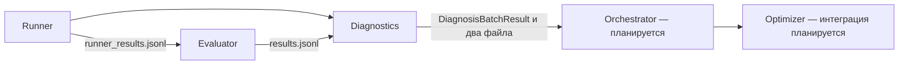

# Архитектура Diagnostics

[Публичный API, форматы файлов и воспроизводимые примеры](../app/diagnostics/README.md)
описаны в README модуля.

## Место в конвейере

Runner, Evaluator и Diagnostics реализованы. Runner возвращает запись на
задание через `AgentRunner.run()`, вызывающая сторона записывает JSONL.
`Evaluator.evaluate()` читает этот файл, рассчитывает оценки и записывает
свой JSONL. `diagnose_run()` использует оба исходных файла и возвращает
результат диагностики, который может использовать вызывающая сторона.

Будущий оркестратор будет вызывать эти модули, выбирать пути и идентификаторы
запуска и версии, сохранять исходные артефакты и управлять общим `LLMService`.
В целевом потоке данных он передаёт отчёты оптимизатору. Контракт отчёта
проверен для передачи Prompt Optimizer, который разрабатывается в отдельной
ветке. Сквозной цикл оптимизации и автоматическая маршрутизация между
оптимизаторами в текущей ветке отсутствуют.

## Этапы обработки

| Этап | Реализация |
| --- | --- |
| Загрузка и объединение | `artifacts.py` проверяет JSONL и строго объединяет одинаковые непустые наборы нормализованных ID. Статусы выполнения и оценки сохраняются раздельно |
| Нормализация | `normalizer.py` преобразует наблюдения Skim Search в `TraceEvent` со ссылками на исходные поля и индексами шагов |
| Детерминированные проверки | `rules.py` фиксирует ошибку выполнения, ошибки инструментов, пустой или невалидный ответ, явное завершение по лимиту и повтор поискового запроса |
| Интерпретация оценок | `quality.py` проверяет четыре оценки Evaluator и формирует сигналы о низком качестве, некорректной оценке или ошибке Evaluator |
| Гипотезы | `hypotheses.py` связывает сигналы с конкретными проверками, которые могут подтвердить или ослабить предполагаемое объяснение |
| Условная классификация | `core.py` отбирает случаи и допустимые категории, `classifier.py` передаёт ограниченные свидетельства через общий `LLMService` |
| Отчёт | `core.py` формирует `DiagnosisReport` со статусом, ведущей категорией, свидетельствами, сигналами и гипотезами. Публичные структуры объявлены в `models.py` |
| Агрегация | `aggregator.py` подсчитывает категории и группирует повторяющиеся сигналы внутри запуска и версии |
| Сохранение | `artifacts.py` публикует `diagnoses.jsonl` и `summary.json` в каталоге, переданном вызывающей стороной |

### Траектория и наблюдаемые нарушения

Нормализатор отдаёт приоритет `args.query`, затем `args.q` и `query`, выбирая
первую непустую строку. Вызов и его строковое наблюдение связаны одним
`tool_call_id`. Завершающие и служебные шаги представлены как
`MODEL_RESPONSE`. Для поля `answer` верхнего уровня формируется один
`FINAL_ANSWER`, если значение отлично от `null`. Пустая строка сохраняется
как наблюдаемое значение. Неполные шаги без признаков действия
сохраняются как `UNKNOWN`. При отсутствии траектории доступны проверки
итоговых полей. `hit_ids` и `read_ids` остаются частью исходных наблюдений
инструментов.

Ошибка инструмента сохраняется как сигнал, даже если агент завершил
выполнение. Более поздний успешный вызов того же инструмента добавляет
свидетельство. Точный повтор поиска с теми же аргументами снижает уровень
сигнала до предупреждения. Полнота восстановления и влияние на ответ
остаются неизвестными. Критический шаг указывается для явно отмеченного
шага остановки по лимиту либо как кандидат для единственной ошибки
инструмента в последнем шаге неуспешного запуска при отсутствии признаков
завершения или успеха на этом шаге.

### От наблюдений к гипотезе

| Сущность | Смысл |
| --- | --- |
| Диагностический сигнал | Запись с идентификатором правила, уровнем, категорией, объяснением и ссылками на свидетельства. Может фиксировать нарушение или предупреждение |
| Наблюдаемое нарушение | Проверяемый факт, например ошибка в результате инструмента, отсутствующий ответ или оценка ниже порога |
| Предполагаемая причина | Возможное объяснение наблюдения, например проблема поиска или неполная интерпретация найденных данных |
| Диагностическая гипотеза | Конкретная проверка для уточнения объяснения, например сравнение пропущенных частей ответа с инструментальными наблюдениями |
| Результат семантической классификации | Предложенная LLM категория из допустимого списка. Это гипотеза с низкой уверенностью и доступными свидетельствами |
| `suggested_scope` | Область проверки основной гипотезы, например промпт или структура агента. Решение о применении изменений принадлежит вызывающей стороне |

Низкие оценки подтверждают результат измерения, а конкретная первопричина
требует дополнительных свидетельств. Например, высокий `retrieval_fact_recall`
отражает содержание успешных наблюдений, а фактический контекст финальной
модели может содержать другой набор сведений. `UNKNOWN` допустим, когда
категория остаётся неустановленной. `NO_FAILURE_DETECTED` распространяется
на выполненные проверки. `FAILURE_FOUND` может отражать техническое
нарушение при правильном ответе. Ошибка Evaluator указывает на невозможность
оценки и сохраняется отдельно от ошибок выполнения агента.

## Ограничения MVP

- Экспериментальная оценка качества диагностики с реальной LLM пока отсутствует.
  Синтетический контрольный набор и тесты с подменой вызовов модели проверяют
  контракты, обработку сбоев и воспроизводимость.
- Входы не содержат фактического финального контекста модели и детализированных
  оценок отдельных утверждений. Агрегированные оценки и наблюдения инструментов
  дают основания для гипотез, но не гарантируют установления первопричины.
- Один отчёт содержит одну основную категорию и один `suggested_scope`.
  Вторичные гипотезы сохраняют собственные области, автоматическая маршрутизация
  этих гипотез между оптимизаторами отсутствует.
- Полноценный оркестратор, хранилище экспериментов и управление версиями
  находятся за пределами реализованного Diagnostics.
