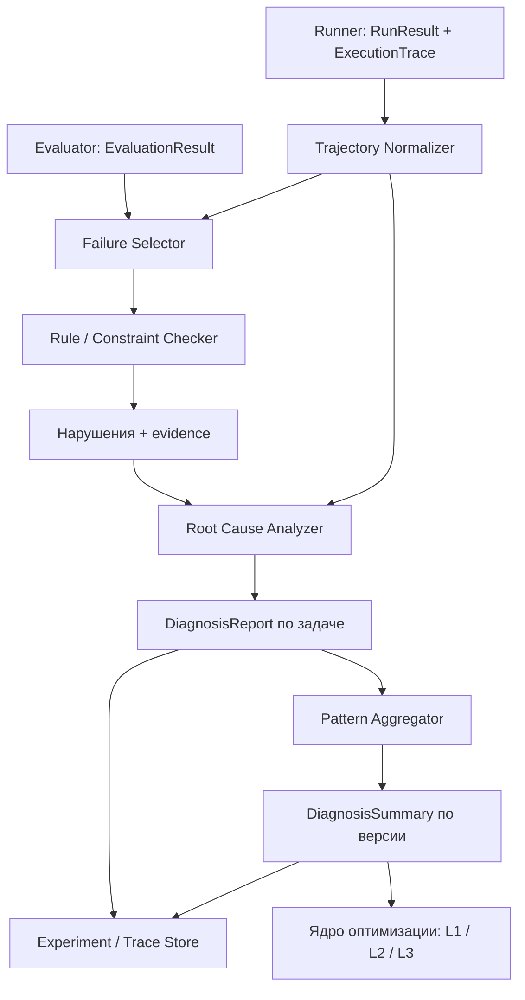
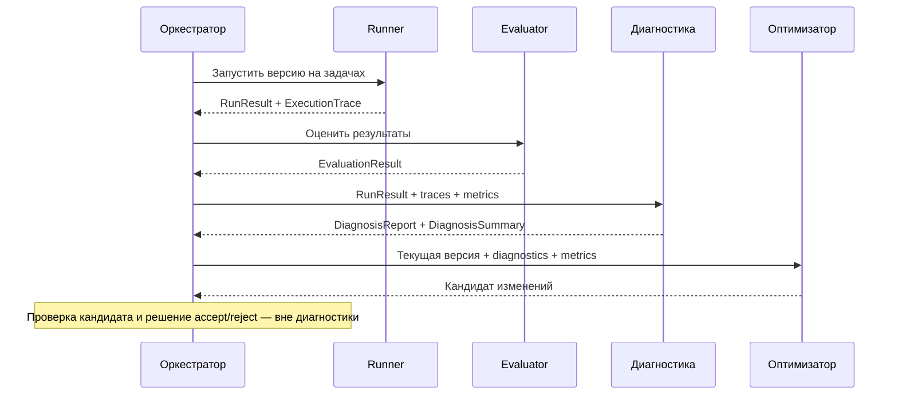

# Диагностический модуль LLM-агента

## 1. Назначение и границы ответственности

Диагностический модуль анализирует **результаты отдельных задач и траектории выполнения агента**, чтобы определить, **где проявилась ошибка, что могло стать её причиной и какими наблюдениями подтверждается вывод**. В отличие от оценщика, который отвечает на вопрос «насколько хорошо сработал агент», диагностика объясняет «что именно пошло не так».

Диагностика используется после запуска агента и расчёта метрик. Результаты нужны оптимизаторам для выбора направлений изменений, а внешней оболочке — для отображения причин неудач и истории эксперимента.

| В зоне ответственности | Вне зоны ответственности |
| --- | --- |
| Нормализация траекторий и связывание событий | Самостоятельный запуск агента и сбор логов — это Runner |
| Выявление нарушений и повторяющихся failure patterns | Расчёт Fact Recall, Faithfulness и других метрик — это Evaluator |
| Локализация критического шага и предполагаемой причины | Редактирование промптов, структуры или кода |
| Выдача обоснованного `DiagnosisReport` | Принятие/отклонение версии по метрикам |
| Подсказка о вероятной области исправления | Формирование конкретного `PromptPatch`, `StructuralChangePlan` или `PatchSet` |

Диагностика может ошибаться: **предполагаемая причина не считается доказанной**, если траектория или метрики не содержат достаточных свидетельств. В таком случае модуль должен явно сообщать об ограниченной уверенности или недостатке данных.

## 2. Что получает диагностический модуль

Диагностика не создаёт собственный benchmark и не собирает повторно данные, которые уже сохранили Runner и Evaluator.

| Источник | Необходимые данные | Для чего используется |
| --- | --- | --- |
| `RunResult` / `AgentRun` | `run_id`, `version_id`, `case_id`/`task_id`, статус, финальный ответ, длительность, ошибки | Определить неуспешные выполнения и связать отчёт с версией |
| `ExecutionTrace` | Последовательность шагов модели, вызовов инструментов, результатов, промежуточных сообщений и ошибок | Найти участок траектории, на котором возникла проблема |
| `EvaluationResult` / `EvaluationReport` | Метрики по каждому заданию и сведения об отсутствующих значениях | Выбрать задачи для анализа и определить вид наблюдаемой неудачи |
| Описание агента и инструментов | Имена, схемы аргументов, ожидаемые форматы результатов, доступные компоненты | Проверять корректность вызовов и соотносить проблему с компонентом |
| Эталонные данные, **если доступны для этого split** | Правильный ответ, обязательные факты, релевантные документы или страницы | Разделять сбой поиска, потерю контекста и ошибку генерации |

При отсутствии эталонных данных модуль продолжает проверять ошибки выполнения и нарушения известных контрактов. Он **не должен выдавать отсутствие релевантных документов или фактов за установленный факт**, если это невозможно проверить.

## 3. Общая архитектура

*Рисунок 1. Место диагностики между выполнением, оценкой и оптимизацией.*

Один диагностический проход включает отбор проблемных задач, проверку последовательности событий, формирование гипотезы о критическом шаге и сохранение отчёта. Обобщение повторяющихся проблем выполняется отдельно — на уровне версии агента.

## 4. Представление траектории и свидетельств

Runner может возвращать разные форматы логов в зависимости от агента. Диагностике нужен единый логический формат событий, но не новый формат выполнения агента.

| Сущность | Минимальное содержание |
| --- | --- |
| `TraceEvent` | `event_id`, `step_index`, `event_type`, `timestamp` (если есть), `component_id`, `payload_ref` |
| Связь инструментов | `tool_call_id`, имя инструмента, аргументы, связанный результат или ошибка |
| `EvidenceRef` | `run_id`, `case_id`, `event_id`/`step_index`, указание поля или артефакта |
| `ConstraintViolation` | Правило, статус проверки, место нарушения, ссылки на свидетельства |

**Типы событий для первой версии:** вызов модели, запрос к инструменту, результат инструмента, передача контекста модели, финальный ответ, ошибка выполнения. Если источник не содержит отдельного события (например, передачи контекста), оно не должно искусственно восстанавливаться как достоверное.

Для выбранного MADQA baseline адаптер может извлекать шаги из полей `trajectory`, `search_history`, `answer`, `citations` и `error`. Для агента на LangGraph те же логические события извлекаются из соответствующих runtime-трасс. **Слой нормализации — единственная часть диагностики, зависящая от исходного формата логов**.

Текст, изображения страниц и большие ответы инструментов необязательно копировать в диагностический отчёт: достаточно ссылок на исходные артефакты, уже сохранённые системой.

## 5. Классификация ошибок

Модуль использует **собственную компактную классификацию для проекта**, опирающуюся на идеи AgentRx и таксономии сбоев tool-augmented LLM. Она не является дословным воспроизведением категорий статей.

| Категория `failure_type` | Что означает | Возможное свидетельство |
| --- | --- | --- |
| `INVALID_TOOL_CALL` | Неверные аргументы или формат вызова инструмента | Ошибка проверки схемы, отсутствующий обязательный аргумент |
| `TOOL_EXECUTION_FAILURE` | Инструмент вызван корректно, но не выполнил действие | Исключение, timeout, ошибка API, недоступный документ |
| `RETRIEVAL_FAILURE` | Не найдена информация, необходимая для ответа | Низкий Retrieval Fact Recall или отсутствие эталонных страниц среди найденных, **если эталон доступен** |
| `CONTEXT_LOSS` | Информация была получена, но не стала доступной на этапе ответа | Нужные факты есть в tool output, но отсутствуют в переданном контексте |
| `TOOL_OUTPUT_MISINTERPRETATION` | Агент неправильно использовал полученные данные | Ответ противоречит явно наблюдаемому результату инструмента |
| `INCOMPLETE_ANSWER` | Агент пропустил необходимые элементы ответа | Низкий Fact Recall при наличии эталонной разметки |
| `UNSUPPORTED_ANSWER` | Ответ содержит неподтверждённые утверждения | Низкая Faithfulness при достаточном наблюдаемом контексте |
| `CITATION_ERROR` | Ответ ссылается на неверный или отсутствующий источник | Ссылки не совпадают с доступными страницами/документами |
| `PREMATURE_STOP` | Работа завершилась до необходимого действия | Агент ответил до поиска либо остановился без результата |
| `INEFFICIENT_LOOP` | Неэффективные повторные действия | Повтор одинакового запроса без новых результатов; лимит итераций |
| `OUTPUT_FORMAT_ERROR` | Итог нарушает ожидаемую схему | Ответ нельзя разобрать или отсутствует обязательное поле |
| `UNKNOWN` | Наблюдений недостаточно для обоснованного вывода | Есть низкая метрика, но траектория не указывает на причину |

**Ошибка выполнения** (`TOOL_EXECUTION_FAILURE`) и **ошибка качества** (`INCOMPLETE_ANSWER`, `RETRIEVAL_FAILURE` и др.) различаются. Завершившийся без исключения агент может ответить неправильно; а неуспешный запуск может не иметь корректной численной оценки.

Критический шаг — не обязательно первый обнаруженный симптом. Например, неверный ответ может возникнуть из-за более раннего игнорирования найденного документа. Если невозможно отделить причину от последствия, возвращается `UNKNOWN` или несколько гипотез с указанием уверенности.

## 6. Как определяется причина ошибки

### 6.1. Первичные проверки

В первой версии используются проверяемые правила: наличие результата выполнения, корректность tool call, успешность вызова, формат финального ответа, отсутствие бесконечных или чрезмерно повторяющихся действий. Метрики оценщика служат **сигналами**, а не автоматическими доказательствами причины.

Примеры различения:

- Низкий Retrieval Fact Recall → **возможная** проблема поиска; подтверждается найденными результатами и, при наличии, эталонными источниками.
- Нужный факт присутствует в результатах инструментов, но отсутствует в финальном ответе → возможная потеря контекста или ошибка использования информации.
- Правильный ответ получен, но ссылки не соответствуют использованным страницам → проблема атрибуции, а не обязательно поиска.

### 6.2. Локализация критического шага

`Root Cause Analyzer` просматривает нарушения в порядке событий и определяет **самый ранний существенный шаг**, после которого ошибка могла повлиять на конечный результат. При этом учитывает, исправлялась ли проблема последующими действиями. Выход должен содержать `critical_step` и связанные `EvidenceRef`, а не только свободное текстовое объяснение.

### 6.3. LLM-анализ неоднозначных случаев

Если однозначного правила нет, можно использовать отдельную LLM как диагностического судью: ей передаются вопрос, ограниченная траектория, полученные нарушения и допустимые категории. Судья выбирает категорию, шаг и краткое обоснование **со ссылками на наблюдаемые события**.

LLM не может добавлять в отчёт вымышленные шаги или утверждать, что видел содержимое, которого нет в артефактах. Если проверяемого обоснования нет, результат помечается `UNKNOWN` или `low confidence`. Наличие LLM-судьи **не обязательно** для работы базовых правил.

## 7. Выходные данные диагностики

Диагностический модуль формирует отчёт **по отдельной задаче** и сводку **по версии агента**.

| Объект | Минимальные поля | Использование |
| --- | --- | --- |
| `DiagnosisReport` | `diagnosis_id`, `run_id`, `version_id`, `case_id`, `status`, `failure_type`, `critical_step`, `evidence_refs`, `rationale`, `confidence`, `suggested_scope` | Диагностика одной задачи; вход оптимизатора |
| `DiagnosisSummary` | `version_id`, `analyzed_cases`, `failure_counts`, `patterns`, ссылки на `DiagnosisReport` | Поиск повторяющихся проблем и выбор следующего направления оптимизации |
| `BehaviorPattern` | `pattern_id`, `affected_tasks`, `critical_steps`, `evidence`, `impact` | Совместимый тип паттерна для prompt-оптимизатора |

Статусы отчёта: `FAILURE_FOUND`, `NO_FAILURE_DETECTED`, `INSUFFICIENT_DATA`, `DIAGNOSTIC_ERROR`. `NO_FAILURE_DETECTED` означает лишь отсутствие установленной ошибки **при выполненных проверках**, а не доказательство полной корректности ответа.

`confidence` может быть простым `low / medium / high`: это **оценка достоверности свидетельств**, а не калиброванная вероятность. Указание конкретного порога уверенности не требуется для MVP.

### 7.1. Подсказка об области исправления

Поле `suggested_scope` сообщает, где **вероятно** стоит искать исправление; это не команда на изменение системы.

| Значение | Типичные случаи | Кому передаётся |
| --- | --- | --- |
| `PROMPT` | Неподходящая инструкция, неверное использование инструмента, пропуск требуемых фактов | L1: Prompt Optimizer |
| `STRUCTURAL` | Не хватает проверки, retry, ограничения контекста, корректной маршрутизации | L2: Structural Optimizer |
| `CODE` | Ошибка parser, tool wrapper, state handling, неверная реализация инструмента | L3: Code Optimizer |
| `UNKNOWN` | Недостаточно доказательств или несколько конкурирующих объяснений | Оркестратор сохраняет для просмотра; автоматическое исправление не обязательно |

Оптимизаторы самостоятельно решают, **какое конкретно изменение** допустимо в их рамках. Например, `Prompt Attribution` из [prompt_optimizer.md](prompt_optimizer.md) дополнительно связывает диагностированный `BehaviorPattern` с редактируемыми компонентами `PromptState`; общий модуль диагностики **не создаёт** `PromptPatch`.

## 8. Подробное описание компонентов

### 8.1. Trajectory Normalizer

**Ответственность.** Преобразует `RunResult` и исходные логи в последовательность `TraceEvent`, сохраняя ссылки на первичные данные.

**Входы.** Run/trace, описание инструментов. **Выходы.** Нормализованная траектория. **Ограничение.** Пропущенные события помечаются как отсутствующие и не дорисовываются.

### 8.2. Failure Selector / Rule Checker

**Ответственность.** Выбирает неуспешные или низкокачественные задачи и выполняет проверяемые ограничения на каждом доступном шаге.

**Входы.** Нормализованная траектория, task-level метрики, tool schemas. **Выходы.** `ConstraintViolation[]` и evidence. **Ограничение.** Проверка исполняется только при наличии нужных данных; отсутствие данных не интерпретируется как нарушение.

### 8.3. Root Cause Analyzer

**Ответственность.** Определяет критический шаг и предполагаемую категорию причины; при необходимости использует LLM-судью.

**Входы.** Trajectory + violations + evaluation signals. **Выходы.** `DiagnosisReport`. **Ограничение.** Объяснение обязано ссылаться на события и явно отражать неопределённость.

### 8.4. Pattern Aggregator

**Ответственность.** Группирует однотипные ошибки нескольких задач по `failure_type` и близким компонентам, чтобы оптимизатор видел повторяющиеся проблемы.

**Входы.** `DiagnosisReport[]` для одной версии. **Выходы.** `DiagnosisSummary` и `BehaviorPattern[]`. **Ограничение.** Не смешивает отчёты разных версий или наборов задач без явного указания источника.

### 8.5. Report Publisher

**Ответственность.** Передаёт отчёты оркестратору и в существующий Experiment/Trace Store.

**Входы.** Reports и summary. **Выходы.** Ссылки на сохранённые диагностические артефакты. **Ограничение.** Не создаёт отдельное независимое хранилище экспериментов.

## 9. Интеграция в общий цикл

*Рисунок 2. Обмен данными между диагностикой и существующими модулями.*

Диагностика работает как **независимый этап после оценки** и не должна блокировать эксперимент при сбое LLM-судьи: в этом случае сохраняются доступные rule-based результаты и ошибка диагностического этапа. В пользовательском интерфейсе достаточно сводки: категории ошибок, число затронутых задач, критические шаги и ссылки на соответствующие траектории.

## 10. Технологии

| Часть | Рабочее решение | Обоснование |
| --- | --- | --- |
| Основная реализация | Python | Тот же язык, что у остальных модулей |
| Схемы диагностических объектов | Pydantic | Единые типизированные контракты с Runner и Optimizers |
| Анализ правил и траекторий | Собственные простые проверки | Детерминированный MVP без обязательной зависимости от LLM |
| Неоднозначные причины | Существующий LLM client через отдельный адаптер, опционально | Семантическое объяснение, когда проверяемых правил недостаточно |
| Хранение | Общий Experiment/Trace Store | Не дублировать инфраструктуру внешней оболочки |
| Тесты | pytest | Проверка правил, локализации, форматов и обработка отсутствующих данных |

Полная реализация AgentRx, причинных графов CHIEF или отдельная graph database **не являются обязательными зависимостями** первой версии. Их идеи используются как методологические ориентиры.

## 11. Тестовая стратегия

Проверять диагностику нужно отдельно от качества самого оптимизатора. Для первой версии достаточно набора вручную размеченных траекторий с известным местом и типом сбоя, включая успешные случаи и неполные логи.

| Проверка | Ожидаемое поведение |
| --- | --- |
| Невалидные аргументы инструмента | Категория `INVALID_TOOL_CALL` со ссылкой на конкретный вызов |
| Инструмент упал, агент завершился | Ошибка выполнения локализована; статус задачи не подменён качественной метрикой |
| Нужный факт найден, но отсутствует в ответе | Сигнал ошибки ответа с доказательством из контекста, если он сохранён |
| Много повторных поисков без новых документов | Отмечена возможная `INEFFICIENT_LOOP`, без необоснованного вывода о причине |
| Не хватает траектории или эталона | `INSUFFICIENT_DATA` или менее конкретная категория; без вымышленных событий |
| Есть промежуточная ошибка, затем исправление | Исправленная ошибка не объявляется автоматически критическим шагом |
| Несколько задач с одной проблемой | `DiagnosisSummary` объединяет их и сохраняет ссылки на отдельные отчёты |
| LLM-судья недоступен | Rule-based диагностика остаётся доступной, ошибка зафиксирована |

Для проверки LLM-атрибуции необходимо отдельно оценивать соответствие указанного `critical_step` и `failure_type` ручной разметке. Нельзя считать правильной диагностику только потому, что после неё какая-то оптимизация улучшила метрику.

## 12. Порядок реализации и критерии готовности MVP

1. Согласовать с Runner/Evaluator поля, доступные в траекториях и task-level результатах; создать нормализатор событий.
2. Реализовать начальные правила обнаружения сбоев инструментов, выполнения, формата и наблюдаемых проблем поиска.
3. Формировать `DiagnosisReport` со ссылками на шаги и `UNKNOWN` при недостаточной информации.
4. Добавить группировку ошибок в `DiagnosisSummary` и подключить вывод к оркестратору.
5. После этого, если требуется, подключить LLM-судью для неоднозначных причин.

**Definition of Done первой версии:** модуль принимает результаты запусков и оценки, выдаёт структурированную диагностику по проблемным задачам, называет предполагаемый критический шаг там, где для этого есть основания, формирует сводку по версии и передаёт данные оптимизаторам без дублирования Runner, Evaluator и Experiment Store.

## 13. Исследовательская опора архитектуры

- **[AgentRx — Diagnosing AI Agent Failures from Execution Trajectories](https://arxiv.org/abs/2602.02475).** Основной ориентир: нормализация траектории, проверка ограничений по шагам, evidence и локализация критической ошибки. Здесь используется **упрощённый** pipeline, а не полное воспроизведение метода.
- **[CHIEF — From Flat Logs to Causal Graphs](https://arxiv.org/abs/2602.23701).** Идея различать первоначальную проблему и её последствия. Полный причинный граф для MVP не нужен, особенно при одном базовом агенте.
- **[A Taxonomy of Failures in Tool-Augmented LLMs](https://doi.org/10.1109/AST66626.2025.00019).** Основа для формализованной классификации ошибок инструментов, их использования и результата работы агента.

Этот документ описывает **предлагаемый модуль диагностики**, поскольку отдельного исходного Word-документа по нему не было. В отличие от четырёх файлов команды, это новая спецификация, а не конвертация чужого текста.
