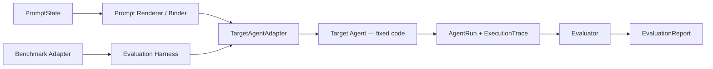
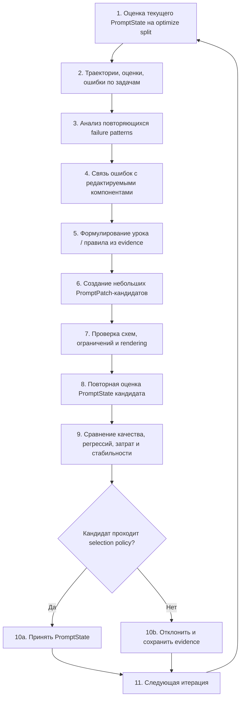
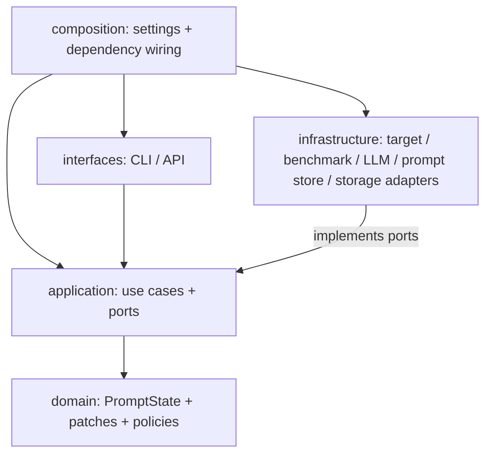

# Prompt-оптимизатор агента

## 1. Цель и границы модуля

Prompt-оптимизатор — внешний meta-agent, который улучшает PromptState целевого LLM-агента на основе execution trajectories и измеряемого результата. Код агента, tool implementations и orchestration остаются фиксированными. Оптимизатор изменяет только явно разрешённые текстовые компоненты, затем повторно запускает target agent через тот же Evaluation Harness и принимает новую prompt-версию только по фактическому улучшению.

Как и кодовый optimizer, этот модуль не привязывается к одному конкретному агенту. Адаптер target agent должен уметь принять PromptState (или отрендеренный PromptBundle) и выполнить Task. Разные агенты могут иметь разные наборы prompt-компонентов, но optimizer работает через единый контракт.

| Можно оптимизировать                                    | Не меняется                  |
|---------------------------------------------------------|------------------------------|
| system prompt и role-specific instructions              | Python-код / workflow        |
| planner / tool-use / verification / output-format rules | реализация tools             |
| tool descriptions, если они объявлены editable          | weights модели               |
| few-shot examples / structured playbook, если разрешены | evaluator и benchmark labels |
| отдельные текстовые компоненты PromptState              | test split и правила scoring |

## 2. Центральный optimization loop

Prompt-оптимизатор использует реальные прогоны target agent. Evaluation Harness запускает одну и ту же версию кода агента с конкретным PromptState на benchmark tasks, собирает AgentRun/ExecutionTrace и score. Затем optimizer анализирует поведение, связывает failure pattern с редактируемым prompt-компонентом, формирует малый PromptPatch и повторно оценивает кандидата.





*Рисунок 1. Контекстная архитектура prompt-оптимизатора*





*Рисунок 2. Один полный цикл prompt-оптимизации*

### 2.1 Как модуль работает целиком

Prompt-оптимизация начинается с фиксации неизменяемой программной версии target agent и исходного PromptState. В optimization run задаются benchmark, evaluator, список разрешённых prompt-компонентов, budget и правила acceptance. Код агента в рамках этого модуля считается фиксированным: изменяется только версионируемая prompt-конфигурация. TargetAgentAdapter скрывает способ подключения prompts к конкретному агенту, поэтому один и тот же optimizer может работать с агентом, который получает system prompt через SDK, читает шаблоны из файлов или поставляется как IDE-плагин.

Первый шаг — получить baseline для исходного PromptState. Prompt Renderer проверяет структуру компонентов, подставляет допустимые переменные и формирует представление, которое понимает конкретный target agent. TargetAgentAdapter связывает полученный prompt с неизменяемой версией агента, после чего Evaluation Harness запускает benchmark-задачи. Для plugin-based агента adapter может записать prompt-конфигурацию в ресурсы или настройки тестовой сборки, запустить отдельный host и затем выполнить задание через публичный контракт плагина.

Evaluation Harness собирает одинаковый набор наблюдений для каждой задачи. Сохраняются финальный ответ, execution trajectory, tool calls, промежуточные события, ошибки, latency и token usage. Evaluator преобразует результат выполнения в EvaluationResult с task-level score и дополнительными метриками. Таким образом prompt optimizer видит не только факт ошибки, но и то, какое поведение предшествовало ошибочному ответу.

Затем система анализирует поведение агента. Behavior Analyzer группирует типичные failures: преждевременный финальный ответ, неверный выбор tool, недостаточную проверку результата, чрезмерное число шагов, нарушение формата или другие повторяющиеся сценарии. Prompt Attribution пытается связать такой паттерн с конкретным компонентом PromptState — например system.core, planner.instructions, описанием инструмента или output.format. Lesson Extractor формулирует компактную гипотезу о том, какое правило или инструкция должны измениться.

На основе этой гипотезы Candidate Generator создаёт PromptPatch. Patch содержит точечные операции над именованными компонентами PromptState: заменить текст, добавить или удалить инструкцию, уточнить tool description, изменить few-shot example или другое разрешённое поле. Предпочтение отдаётся минимальным изменениям, чтобы было понятно, какая именно модификация повлияла на поведение. Каждый кандидат получает parent_id и собственный immutable version id.

До запуска кандидата выполняется prompt-level validation. Prompt Guard проверяет наличие обязательных компонентов, сохранность template variables, соответствие tool names реальным инструментам, ограничения по длине, запрещённые изменения и формат structured-output инструкций. Prompt Renderer затем убеждается, что кандидат корректно компилируется или связывается с target agent. Невалидный PromptState отклоняется до затрат на benchmark execution.

Валидный PromptState оценивается на target agent повторно. Программная версия агента, evaluator и условия benchmark остаются теми же, меняется только prompt candidate. Это позволяет сравнивать parent и candidate как контролируемый эксперимент. Candidate Comparator анализирует основную метрику качества и guardrails, включая latency, token cost, crash rate и другие показатели, после чего Selection Policy принимает или отклоняет candidate.

Принятый PromptState становится parent следующей итерации. Prompt Version Store сохраняет его lineage и содержимое компонентов, а Experiment Store — конфигурацию запуска, результаты по задачам, traces, attribution, PromptPatch и решение comparator. Отклонённые версии тоже сохраняются как история эксперимента, но никогда не подменяют активный prompt. Так можно восстановить, какое изменение привело к конкретному изменению метрик.

Оптимизация повторяется до выполнения stop condition. На каждой итерации система снова ищет слабые места уже у текущего принятого PromptState и предлагает следующую локальную модификацию. Train/validation/test split используется так, чтобы генерация prompt-кандидатов не получала доступ к финальному test-набору. Итогом работы модуля является лучшая подтверждённая PromptVersion с полным experiment bundle и воспроизводимой историей изменений.

## 3. PromptState как версионируемый объект

Prompt нельзя хранить как одну неструктурированную строку. PromptState состоит из именованных компонентов, каждый имеет id, тип, шаблон, переменные, ограничения и версию. Это позволяет диагностировать и изменять конкретную часть контекста, а не переписывать всё сразу.

PromptState  
├── system.core  
├── planner.instructions  
├── tools.search.description  
├── tools.read.description  
├── verifier.instructions  
├── output.format  
└── few_shot.examples

| Сущность             | Минимальные поля                                                                      |
|----------------------|---------------------------------------------------------------------------------------|
| PromptComponent      | component_id, role/type, template, variables, editable, max_length                    |
| PromptState          | prompt_version_id, parent_id, components, renderer_version, metadata                  |
| PromptPatch          | patch_id, component_id, operation, before_hash, new_content, rationale, evidence_refs |
| RenderedPromptBundle | prompt_version_id, rendered_messages/tool descriptions, content_hash                  |
| AgentRun             | task_id, prompt_version_id, output, status, token_usage, latency, artifact_refs       |
| ExecutionTrace       | ordered events including messages/tool calls/tool outputs/errors                      |
| EvaluationResult     | task score + auxiliary metrics                                                        |
| BehaviorPattern      | pattern_id, affected_tasks, critical steps, evidence, impact                          |
| PromptDiagnosis      | pattern_id, attributed_components, confidence, rationale                              |
| PromptCandidate      | candidate_id, parent_prompt_version, patches, checks, evaluation_summary              |

## 4. Универсальный target-agent contract

TargetAgentAdapter отвечает только за применение PromptState к конкретному агенту и запуск задачи. Для одного агента system prompt может передаваться через constructor, для другого — через config-файл, для третьего — через framework callback. Эти различия остаются внутри adapter-а.

```python
class TargetAgentPort(Protocol):
    def describe(self) -> PromptTargetDescriptor: ...
    def render_or_bind(self, prompt_state: PromptState) -> BoundPromptTarget: ...
    def run(self, target: BoundPromptTarget, task: Task, seed: int) -> AgentRun: ...

class PromptTargetDescriptor(BaseModel):
    target_id: str
    editable_components: list[PromptComponentSpec]
    fixed_components: list[str]
    runtime_capabilities: set[str]
```


## 5. Подробное описание модулей

### 5.1 Optimization Orchestrator

Расположение: application/use_cases/optimize_prompts.py

Управляет prompt optimization session: baseline evaluation → behavior analysis → attribution → reflection → candidate generation → prompt validation → candidate evaluation → selection.

| Аспект               | Спецификация                                                                                              |
|----------------------|-----------------------------------------------------------------------------------------------------------|
| Входы                | Target id, initial PromptState, benchmark config, budget.                                                 |
| Выходы               | OptimizationSessionResult и lineage PromptState.                                                          |
| Ошибки / ограничения | При ошибке сохраняет iteration state и уже собранные artifacts; повтор запуска должен быть идемпотентным. |

### 5.2 Evaluation Harness

Расположение: application/services/evaluation_harness.py

Запускает фиксированный код target agent с конкретной prompt-версией на benchmark.

| Аспект               | Спецификация                                                                                    |
|----------------------|-------------------------------------------------------------------------------------------------|
| Входы                | PromptState id, tasks/split, seed/config.                                                       |
| Выходы               | EvaluationReport + trace refs.                                                                  |
| Ошибки / ограничения | Parent и candidate должны проходить идентичный runtime/evaluator; иначе сравнение недостоверно. |

### 5.3 Prompt Renderer / Binder

Расположение: application/services/prompt_renderer.py

Рендерит компоненты с переменными и преобразует PromptState в формат конкретного adapter-а.

| Аспект               | Спецификация                                                                                                               |
|----------------------|----------------------------------------------------------------------------------------------------------------------------|
| Входы                | PromptState + runtime variables/tool schemas.                                                                              |
| Выходы               | RenderedPromptBundle.                                                                                                      |
| Ошибки / ограничения | Детерминированный renderer; hash результата сохраняется. Неразрешённые переменные или schema mismatch блокируют candidate. |

### 5.4 Behavior Analyzer

Расположение: application/services/behavior_analyzer.py

Ищет повторяющиеся поведенческие паттерны в failed и regressed tasks.

| Аспект               | Спецификация                                                                        |
|----------------------|-------------------------------------------------------------------------------------|
| Входы                | EvaluationReport + trajectories.                                                    |
| Выходы               | BehaviorPattern\[\].                                                                |
| Ошибки / ограничения | Паттерн должен ссылаться на конкретные task/steps; только общий score недостаточен. |

### 5.5 Prompt Attribution

Расположение: application/services/prompt_attribution.py

Определяет, какой editable component потенциально связан с observed failure.

| Аспект               | Спецификация                                                                                                                                      |
|----------------------|---------------------------------------------------------------------------------------------------------------------------------------------------|
| Входы                | BehaviorPattern, PromptState, traces, tool schemas.                                                                                               |
| Выходы               | PromptDiagnosis.                                                                                                                                  |
| Ошибки / ограничения | Можно использовать rule mapping + LLM judge. Если причина явно относится к коду/tool implementation, diagnosis должен вернуть NOT_PROMPT_FIXABLE. |

### 5.6 Reflection / Lesson Extractor

Расположение: application/services/reflection.py

Формулирует обобщаемое правило из нескольких evidence cases, а не локальную подсказку под один пример.

| Аспект               | Спецификация                                                                                    |
|----------------------|-------------------------------------------------------------------------------------------------|
| Входы                | PromptDiagnosis + failed/success contrasts.                                                     |
| Выходы               | PromptLesson\[\].                                                                               |
| Ошибки / ограничения | Lesson должен быть кратким, не содержать gold answer конкретной задачи и ссылаться на evidence. |

### 5.7 Prompt Candidate Generator

Расположение: application/ports/prompt_model.py + application/services/candidate_generator.py

Преобразует lesson в 1–N малых PromptPatch.

| Аспект               | Спецификация                                                                                         |
|----------------------|------------------------------------------------------------------------------------------------------|
| Входы                | PromptState + PromptLesson + component constraints.                                                  |
| Выходы               | PromptPatch\[\].                                                                                     |
| Ошибки / ограничения | По умолчанию один patch изменяет один component. Full rewrite разрешать только отдельной стратегией. |

### 5.8 Prompt Guard

Расположение: domain/policies/prompt_policy.py

Проверяет допустимость изменения до запуска агента.

| Аспект               | Спецификация                                                                                                                      |
|----------------------|-----------------------------------------------------------------------------------------------------------------------------------|
| Входы                | PromptPatch + component spec.                                                                                                     |
| Выходы               | GuardDecision.                                                                                                                    |
| Ошибки / ограничения | Запрет изменения fixed components, запрещённых placeholders, secret leakage, чрезмерного роста длины, конфликтующих output rules. |

### 5.9 Prompt Version Store

Расположение: application/ports/prompt_store.py + infrastructure/persistence/\*

Хранит immutable PromptState и parent-child lineage.

| Аспект               | Спецификация                                                                |
|----------------------|-----------------------------------------------------------------------------|
| Входы                | Accepted/generated patches.                                                 |
| Выходы               | Новая prompt version.                                                       |
| Ошибки / ограничения | Каждая версия content-addressed; никогда не перезаписывать parent in-place. |

### 5.10 Candidate Comparator / Selection Policy

Расположение: domain/policies/selection_policy.py

Сравнивает prompt candidate с parent на измеряемых метриках.

| Аспект               | Спецификация                                                                                                     |
|----------------------|------------------------------------------------------------------------------------------------------------------|
| Входы                | Parent/candidate EvaluationReport, token/latency data.                                                           |
| Выходы               | Accept/Reject.                                                                                                   |
| Ошибки / ограничения | Primary score + regression ceiling + optional context/token cost. Не принимать кандидата только по LLM critique. |

### 5.11 Experiment Store / Trace Store

Расположение: application/ports/repositories.py

Сохраняет configs, prompt versions, lessons, traces, per-task results и decisions.

| Аспект               | Спецификация                                                                          |
|----------------------|---------------------------------------------------------------------------------------|
| Входы                | Все artifacts optimization session.                                                   |
| Выходы               | Воспроизводимая история.                                                              |
| Ошибки / ограничения | Следует хранить rejected candidates: они важны для анализа и предотвращения повторов. |

## 6. Операции PromptPatch

Для воспроизводимости optimizer изменяет PromptState через ограниченный набор операций. Это предпочтительнее свободной перезаписи полного prompt.

| Операция                     | Смысл                                                   | Пример использования                                  |
|------------------------------|---------------------------------------------------------|-------------------------------------------------------|
| REPLACE_COMPONENT            | Полностью заменить один небольшой компонент             | Переписать verifier.instructions                      |
| APPEND_RULE                  | Добавить независимое правило в структурированный список | Требовать evidence перед финальным ответом            |
| UPDATE_RULE                  | Изменить существующее правило по stable rule id         | Уточнить условие вызова search tool                   |
| REMOVE_RULE                  | Удалить правило, признанное вредным/дублирующим         | Убрать конфликтующую инструкцию                       |
| ADD_EXAMPLE / REMOVE_EXAMPLE | Изменить few-shot subset                                | Добавить демонстрацию правильной обработки tool error |

```python
class PromptPatch(BaseModel):
    patch_id: UUID
    component_id: str
    operation: PatchOperation
    before_hash: str
    payload: str | PromptRule | FewShotExample
    rationale: str
    evidence_refs: list[ArtifactRef]
```


## 7. Рекомендуемая структура пакета

```text
prompt-optimizer/
├── pyproject.toml
├── configs/
│ ├── optimizer.yaml
│ ├── targets/
│ └── benchmarks/
├── src/prompt_optimizer/
│ ├── domain/
│ │ ├── entities/
│ │ │ ├── prompt_state.py
│ │ │ ├── candidate.py
│ │ │ └── behavior.py
│ │ ├── value_objects/
│ │ │ ├── prompt_patch.py
│ │ │ ├── metrics.py
│ │ │ └── identifiers.py
│ │ └── policies/
│ │ ├── prompt_policy.py
│ │ └── selection_policy.py
│ ├── application/
│ │ ├── use_cases/
│ │ │ ├── optimize_prompts.py
│ │ │ ├── evaluate_prompt_state.py
│ │ │ ├── diagnose_behavior.py
│ │ │ ├── generate_candidates.py
│ │ │ └── validate_prompt_candidate.py
│ │ ├── services/
│ │ │ ├── evaluation_harness.py
│ │ │ ├── behavior_analyzer.py
│ │ │ ├── prompt_attribution.py
│ │ │ ├── reflection.py
│ │ │ └── prompt_renderer.py
│ │ └── ports/
│ │ ├── target_agent.py
│ │ ├── benchmark.py
│ │ ├── evaluator.py
│ │ ├── prompt_model.py
│ │ ├── prompt_store.py
│ │ └── repositories.py
│ ├── infrastructure/
│ │ ├── target_adapters/
│ │ ├── benchmark_adapters/
│ │ ├── evaluators/
│ │ ├── llm/
│ │ └── persistence/
│ ├── interfaces/
│ │ ├── cli/
│ │ └── api/
│ └── composition/
│ ├── container.py
│ └── settings.py
└── tests/
├── unit/domain/
├── unit/application/
├── contract/
├── integration/
└── e2e/
```





*Рисунок 3. Допустимое направление зависимостей пакетов*

## 8. Конфигурация optimization run

```yaml
experiment:
  id: doc-agent-prompt-v1
  seed: 42

target:
  adapter: document_agent
  prompt_state: prompts/baseline.yaml
  editable_components:
    - system.core
    - planner.instructions
    - verifier.instructions
    - output.format
  fixed_components:
    - policy.safety

benchmark:
  adapter: project_dataset
  optimize_split: train
  validation_split: validation
  final_test_split: test

generation:
  candidates_per_iteration: 4
  max_component_growth_chars: 1500
  prefer_delta_edits: true

evaluation:
  concurrency: 4
  per_task_timeout_sec: 180

selection:
  primary_metric: task_success_rate
  min_delta: 0.01
  max_regressions: 3
  max_token_cost_ratio: 1.15

budget:
  max_iterations: 20
  max_llm_calls: 100
```


## 9. Защита от prompt overfitting

- Optimizer видит optimization/search split, но не final test answers.

- PromptLesson должен обобщать правило, а не вставлять ответ или id конкретной задачи.

- Кандидат сравнивается не только по среднему score, но и по regression count.

- Validation split используется для выбора устойчивой версии, а test — только для финального измерения.

- Хранить длину prompt, input tokens и latency: улучшение за счёт неограниченного разрастания контекста должно быть видно.

- Для stochastic target agent фиксировать seeds/repeats и сравнивать версии в одинаковых условиях.

## 10. Тестовая стратегия

| Уровень           | Что тестируем                                                                                                                  |
|-------------------|--------------------------------------------------------------------------------------------------------------------------------|
| Unit: domain      | PromptPatch application, PromptPolicy, SelectionPolicy, immutable PromptState.                                                 |
| Unit: application | BehaviorAnalyzer/Attribution/Reflection use cases на fake traces и fake LLM.                                                   |
| Contract          | TargetAgentAdapter корректно применяет все declared editable components.                                                       |
| Integration       | Prompt store, real renderer, LLM adapter, benchmark/evaluator.                                                                 |
| E2E               | Dummy agent с намеренно плохой инструкцией: optimizer должен предложить patch, который повышает deterministic benchmark score. |
| Regression        | Accepted PromptState не ломает заранее определённый набор previously-passed tasks сверх configured ceiling.                    |

## 11. Порядок реализации

1.  Определить PromptState, PromptComponent, PromptPatch и immutable versioning.

2.  Определить TargetAgent/Benchmark/Evaluator ports и fake implementations.

3.  Реализовать deterministic PromptRenderer и contract tests.

4.  Собрать EvaluationHarness на DummyTargetAgent и получить per-task traces/scores.

5.  Реализовать BehaviorAnalyzer и простой PromptAttribution.

6.  Добавить Reflection и PromptModelPort с structured output.

7.  Добавить PromptPolicy, candidate generation и PromptVersionStore.

8.  Собрать comparator/selection и полный optimization loop.

9.  Подключить первый реальный target agent через adapter.

10. После устойчивого MVP добавлять несколько mutation strategies, Pareto selection, few-shot optimization и более сложный attribution.

## 12. Definition of Done для MVP

- CLI запускает optimization session из конфига и конкретного PromptState.

- Baseline prompt оценивается автоматически и сохраняет traces/scores.

- BehaviorAnalyzer формирует evidence-backed pattern хотя бы для одного типа ошибок.

- PromptAttribution выбирает editable component либо явно возвращает NOT_PROMPT_FIXABLE.

- Optimizer генерирует структурированный PromptPatch, а не произвольный полный prompt.

- PromptGuard отклоняет изменения fixed components и некорректный render.

- Candidate PromptState повторно прогоняется на том же harness/evaluator.

- SelectionPolicy автоматически принимает/отклоняет кандидата по сохранённым правилам.

- Вся lineage prompt versions и rejected candidates сохраняется.

- Новый target agent подключается через adapter и декларацию prompt components без переписывания domain/application слоя.

## Исследовательская опора архитектуры

- GEPA — Reflective Prompt Evolution Can Outperform Reinforcement Learning: prompt optimizer, который использует system-level trajectories, natural-language reflection, proposal и тестирование prompt updates; важная основа для behavior-driven prompt optimization. https://arxiv.org/abs/2507.19457

- Meta-Harness — End-to-End Optimization of Model Harnesses: показывает ценность доступа оптимизатора к богатой истории execution traces и scores, а не только к скалярной метрике. https://arxiv.org/abs/2603.28052

- AgentRx — Diagnosing AI Agent Failures from Execution Trajectories: поддерживает идею evidence-backed localization критического шага перед попыткой исправления. https://arxiv.org/abs/2602.02475

- AFlow — Automating Agentic Workflow Generation: подтверждает общий принцип execution-feedback optimization: кандидат изменяется и затем оценивается на benchmark. https://arxiv.org/abs/2410.10762
