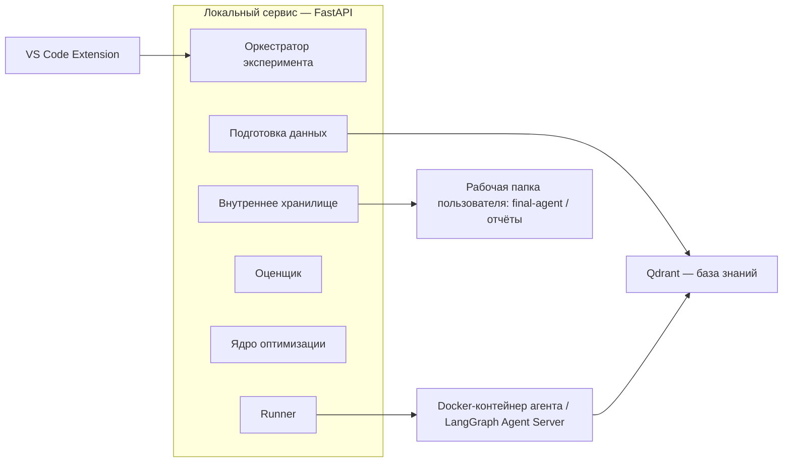
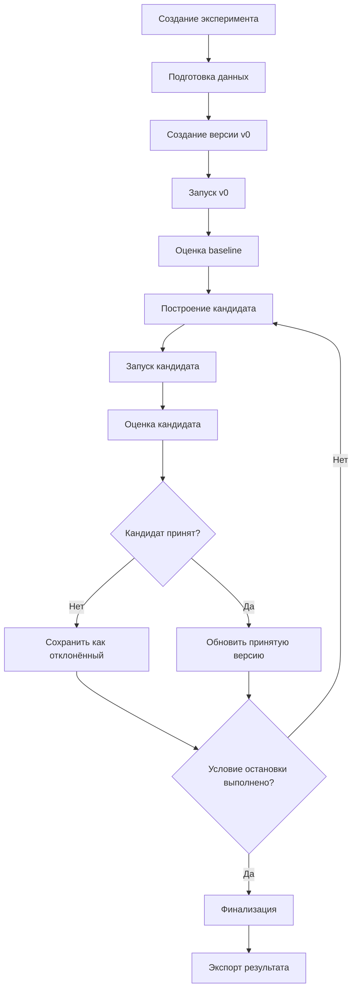
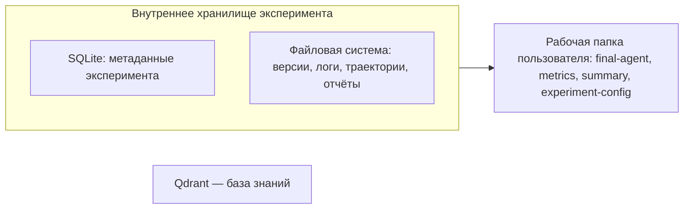
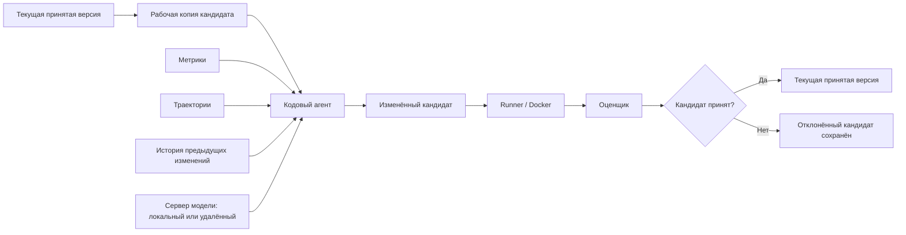

# Внешняя оболочка сервиса оптимизации LLM-агентов

## 1. Общая схема

Пользователь работает с агентом в обычной рабочей папке VS Code. Расширение VS Code служит панелью управления: в нём выбираются проект агента, данные, режим оптимизации, метрики и основные параметры запуска. После нажатия Start управление переходит локальному сервису на FastAPI.

Бэкенд создаёт эксперимент, подготавливает данные, копирует исходную версию агента во внутреннее хранилище, запускает её, передаёт результаты оценщику и ядру оптимизации, сохраняет историю попыток и в конце возвращает в рабочую папку итоговую версию агента и отчёт по эксперименту.





*Рисунок 1 — Общая архитектура внешней оболочки*

Расширение отвечает за работу с пользователем. Все вычисления и управление экспериментом находятся на стороне бэкенда.

## 2. Что пользователь задаёт перед запуском

В первой версии одновременно выполняется один эксперимент. Перед запуском пользователь задаёт четыре группы параметров.

| **Группа**  | **Что указывает пользователь**                                                        | **Как это используется**                                                                             |
|-------------|---------------------------------------------------------------------------------------|------------------------------------------------------------------------------------------------------|
| Агент       | Путь к папке проекта агента                                                           | Бэкенд создаёт исходную копию v0 и передаёт её модулю запуска.                                       |
| Данные      | Путь к корпусу документов и путь к тестовому набору                                   | Корпус проходит подготовку и загружается в Qdrant; тестовый набор используется при запуске и оценке. |
| Оценка      | Набор метрик и основная метрика                                                       | Одинаковая конфигурация используется для исходной версии и всех кандидатов.                          |
| Оптимизация | Режим: промпты / структура / код / автоматический; число итераций и условия остановки | Эти настройки задают доступный уровень изменений и длительность эксперимента.                        |

Служебные параметры — пути внутри контейнеров, идентификатор коллекции Qdrant, внутренние каталоги и адреса локальных сервисов — формирует бэкенд.

```text
Конфигурация запуска
agent_path
documents_path
evaluation_dataset_path
optimization_mode
selected_metrics / primary_metric
max_iterations / stop_settings
```

Во время эксперимента основные поля формы блокируются. Пользователь видит текущий этап, номер итерации и изменение метрик.

## 3. Как проходит эксперимент

Порядком действий управляет оркестратор эксперимента внутри FastAPI-сервиса. Его задача — вызвать нужные модули в правильной последовательности и сохранить результат каждого шага.

1.  Создать эксперимент и его внутренние каталоги.

2.  Подготовить корпус документов и создать базу знаний в Qdrant.

3.  Скопировать исходный проект агента во внутреннее хранилище как версию v0.

4.  Запустить v0 на тестовом наборе и получить результаты выполнения.

5.  Передать результаты оценщику и сохранить исходные метрики.

6.  Создать рабочую папку для следующего кандидата как копию текущей принятой версии.

7.  Передать эту папку и контекст эксперимента ядру оптимизации.

8.  Запустить полученного кандидата тем же способом, что и исходную версию.

9.  Оценить кандидата тем же набором метрик.

10. Применить правило принятия. Если кандидат проходит проверку, сделать его текущей принятой версией; в остальных случаях сохранить предыдущую.

11. Повторять цикл до выполнения условия остановки.

12. Скопировать последнюю принятую версию и итоговые материалы в рабочую папку пользователя.





*Рисунок 2 — Жизненный цикл эксперимента*

## 4. Подготовка документов

Корпус документов и тестовый набор выполняют разные роли. Корпус — источник знаний для агента. Тестовый набор содержит вопросы и эталонные данные, по которым оценивается качество ответа.

В первой версии используется единый конвейер подготовки документов. Пользователь передаёт поддерживаемые файлы, после чего бэкенд выполняет разбор текста, разбиение на фрагменты, построение эмбеддингов и загрузку в Qdrant.

```text
документы
↓
разбор и нормализация
↓
разбиение на фрагменты
↓
эмбеддинги
↓
коллекция Qdrant
↓
инструмент поиска агента
```

После подготовки бэкенд сохраняет ссылку на созданную коллекцию Qdrant. Все версии агента внутри одного эксперимента работают с одной и той же коллекцией, поэтому изменение качества связано с изменениями агента, а не с другой индексацией документов.

## 5. Как хранится и запускается проект агента

Исходный проект пользователя сохраняется без изменений. В начале эксперимента бэкенд делает полную копию проекта во внутреннее хранилище; эта копия становится версией v0. Каждый новый кандидат также хранится как отдельная физическая папка.

```text
рабочая папка пользователя/agent/ — исходный проект
внутреннее хранилище/versions/
v0/
candidate_001/
candidate_002/
...
```

Для первой версии поддерживается агент на LangGraph с заранее известным способом запуска. Это позволяет модулю запуска работать со всеми версиями одинаково.

### 5.1. Минимальные требования к LangGraph-проекту

| **Что должно быть определено** | **Для чего это нужно**                                                                                                                         |
|--------------------------------|------------------------------------------------------------------------------------------------------------------------------------------------|
| Точка входа в граф             | Модуль запуска должен однозначно понимать, какой граф поднимать. Рабочий вариант — конфигурация LangGraph или отдельная конфигурация адаптера. |
| Зависимости проекта            | Контейнер должен уметь установить окружение из заранее поддерживаемого файла зависимостей, например pyproject.toml или requirements.txt.       |
| Вход одного задания            | Должен быть определён формат, в котором агент получает вопрос, case_id и при необходимости служебный контекст.                                 |
| Финальный ответ                | Модуль запуска должен получать итоговый ответ из результата графа по известному правилу.                                                       |
| Траектория выполнения          | Из запуска должны извлекаться промежуточные шаги, вызовы инструментов, результаты инструментов и ошибки.                                       |
| Доступ к базе знаний           | Параметры Qdrant передаются через конфигурацию среды запуска.                                                                                  |
| Модели и инструменты           | Адреса моделей, ключи и настройки известных инструментов также передаются через среду запуска.                                                 |

```text
agent-project/
├─ исходный код и описание графа
├─ конфигурация точки входа
├─ файл зависимостей
├─ промпты / описания инструментов / настройки агента
└─ остальные файлы проекта
```

## 6. Модуль запуска агента

Модуль запуска (Runner) получает конкретную версию агента и выполняет её на тестовом наборе. Он одинаково работает с v0 и со всеми последующими кандидатами. Его задача — запустить версию в изолированной среде и вернуть полный результат выполнения оркестратору.

| **На входе**               | **На выходе**                                            |
|----------------------------|----------------------------------------------------------|
| Путь к версии агента       | run_id и связь с версией                                 |
| Тестовые задания           | Финальный ответ по каждому заданию                       |
| Ссылка на коллекцию Qdrant | Вызовы инструментов и их аргументы                       |
| Настройки модели и среды   | Результаты инструментов и найденный контекст             |
| Параметры запуска          | Траектория выполнения, время и использование токенов/API |

После запуска Runner возвращает RunResult. Сохранением RunResult, траекторий и остальных файлов занимается оркестратор вместе с внутренним хранилищем. Благодаря этому Runner не зависит от структуры SQLite и каталогов эксперимента.

Для первой реализации основной способ запуска — LangGraph Agent Server внутри контейнера конкретного запуска. Интерфейс Runner при этом остаётся отдельным слоем, поэтому способ интеграции с LangGraph можно заменить адаптером без изменений в оркестраторе.

### 6.1. Docker и процессы вокруг запуска

Каждая версия агента запускается в отдельном контейнере Docker. Это особенно важно для структурной и программной оптимизации, когда код кандидата меняется автоматически.

| **Процесс**                   | **Как он живёт**                                                                                                                 |
|-------------------------------|----------------------------------------------------------------------------------------------------------------------------------|
| VS Code Extension             | Работает внутри VS Code и обращается к локальному FastAPI-сервису.                                                               |
| FastAPI-сервис                | Долгоживущий локальный процесс, который управляет экспериментом.                                                                 |
| Qdrant                        | Долгоживущий сервис. Для каждого эксперимента создаётся отдельная коллекция.                                                     |
| Контейнер агента              | Создаётся для конкретного запуска версии. После завершения запуска контейнер освобождается, а папка версии остаётся в хранилище. |
| LangGraph Agent Server        | Запускается вместе с контейнером агента и предоставляет Runner единый интерфейс к графу.                                         |
| Сервер модели кодового агента | Отдельный сервис для уровня оптимизации кода; может быть локальным или удалённым.                                                |

```text
VS Code Extension
↓
FastAPI / оркестратор
├─ Qdrant
└─ Runner
↓
Docker-контейнер
└─ LangGraph Agent Server
Для оптимизации кода:
ядро оптимизации → кодовый агент → сервер модели
```

## 7. Основные сущности эксперимента

| **Сущность**         | **Что она означает**                                                                                  |
|----------------------|-------------------------------------------------------------------------------------------------------|
| Эксперимент          | Один полный запуск оптимизации с фиксированными входными данными и настройками.                       |
| Версия агента        | Физическая папка с конкретным состоянием агента: v0 или один из кандидатов.                           |
| Кандидат             | Версия, созданная в одной итерации оптимизации. После оценки получает статус «принят» или «отклонён». |
| Запуск               | Один запуск конкретной версии агента на тестовом наборе.                                              |
| Оценка               | Метрики, рассчитанные для конкретного запуска.                                                        |
| Итерация оптимизации | Одна попытка улучшения: текущая принятая версия → один кандидат → запуск → оценка → решение.          |
| Артефакт             | Файл или папка, связанная с экспериментом: версия агента, траектория, лог, отчёт и т. п.              |

Одна итерация создаёт одного кандидата. После его оценки начинается следующая итерация.

### 7.1. Данные, которыми обмениваются модули

Ниже показаны логические структуры данных. Это ориентир для реализации моделей и интерфейсов; конкретные имена полей можно уточнить при написании кода.

```text
ExperimentCreateConfig
agent_path
documents_path
evaluation_dataset_path
optimization_mode
selected_metrics / primary_metric
max_iterations / stop_settings
Experiment
experiment_id
config
current_accepted_version_id
current_iteration
RunRequest
experiment_id
version_id + version_path
test_cases
knowledge_base_ref
runtime_settings
RunResult
run_id + version_id
cases[]:
case_id
final_answer
trajectory
tool_calls / tool_outputs
usage / timing
EvaluationResult
evaluation_id + run_id
per_case_metrics
aggregate_metrics
primary_metric
CandidateResult
candidate_version_id + candidate_path
parent_version_id
optimization_level
change_summary
optimizer_artifacts
```

## 8. Оценка результата

Оценщик (Evaluator) вызывается после запуска v0 и после каждого кандидата. Он получает тестовый набор и фактический результат работы агента, после чего рассчитывает метрики по каждому заданию и по версии в целом.

```text
Вход оценщика
question / case_id
reference_facts (+ reference_answer при необходимости)
final_answer
tool_outputs / retrieved_context
sources / citations, если они есть
Результат оценки
per_case_metrics
aggregate_metrics
primary_metric
дополнительные данные для сравнения версий
```

Основной метрикой планируется Fact Recall. Дополнительно используются Fact Precision, Retrieval/Tool Recall и Faithfulness. Для расчёта предполагается использовать RAGAS и собственную логику. Подробные правила расчёта и агрегации будут описаны в отдельном документе по оценщику.

## 9. Ядро оптимизации и создание кандидатов

Перед каждой итерацией оркестратор создаёт новую рабочую папку кандидата как копию текущей принятой версии. Ядро оптимизации получает путь к этой папке и изменяет её в рамках выбранного уровня оптимизации. Так ядро оптимизации работает с готовой рабочей копией и не управляет структурой внутреннего хранилища.

```text
current accepted version
↓ копия, созданная оркестратором
candidate_005/
↓
ядро оптимизации изменяет эту папку
↓
CandidateResult
↓
Runner → Evaluator
```

На вход ядру оптимизации передаются текущая принятая версия, результаты оценки и запуска, траектории, диагностическая информация, режим оптимизации и история предыдущих попыток. История включает как принятые, так и отклонённые кандидаты, чтобы следующая попытка учитывала уже проверенные изменения.

| **Уровень** | **Что может менять ядро оптимизации**                                                                                   |
|-------------|-------------------------------------------------------------------------------------------------------------------------|
| Уровень 1   | Промпты, описания инструментов и другие текстовые параметры.                                                            |
| Уровень 2   | Структуру графа, маршрутизацию, память, проверки, повторные попытки и другие заранее поддержанные структурные элементы. |
| Уровень 3   | Код проекта через кодовый агент.                                                                                        |

### 9.1. Как принимается или отклоняется кандидат

Оценщик только рассчитывает метрики. Отдельное правило принятия сравнивает кандидата с текущей принятой версией по основной и дополнительным метрикам. Это правило относится к слою оптимизации; оркестратор вызывает его, сохраняет решение и при принятии обновляет указатель на текущую принятую версию.

```text
v0 [текущая принятая версия]
├─ candidate_001 [отклонён]
└─ candidate_002 [принят] ← текущая принятая версия
├─ candidate_003 [отклонён]
└─ candidate_004 [принят] ← текущая принятая версия
```

После принятия физическая папка сохраняет имя candidate_XXX. Создавать дополнительную копию с именем v1, v2 и т. д. не требуется: статус версии и указатель current_accepted_version_id хранятся в метаданных.

Следующая итерация всегда строится от последней принятой версии. Если эксперимент завершается после нескольких отклонённых попыток, итоговой остаётся последняя принятая версия.

## 10. Внутреннее хранилище эксперимента

История эксперимента хранится в двух частях: небольшие связанные данные — в SQLite, большие файлы и папки — в файловой системе. Qdrant хранит подготовленную базу знаний.

| **Хранилище**    | **Что в нём лежит**                                                                                                                                                                  |
|------------------|--------------------------------------------------------------------------------------------------------------------------------------------------------------------------------------|
| SQLite           | Идентификатор эксперимента, конфигурация, текущая принятая версия, номер итерации, связи между версиями, запусками и оценками, статусы кандидатов, итоговые метрики и пути к файлам. |
| Файловая система | Полные папки v0 и всех кандидатов, траектории, исходные результаты запусков, логи, отчёты оценщика и ядра оптимизации.                                                               |
| Qdrant           | Коллекция с подготовленными документами для конкретного эксперимента.                                                                                                                |

Все кандидаты сохраняются полностью, в том числе отклонённые. Это позволяет вернуться к любой попытке и передавать следующему шагу оптимизации информацию о том, что уже менялось и к чему это привело.

```text
experiment_001/
├─ versions/
│ ├─ v0/
│ ├─ candidate_001/
│ ├─ candidate_002/
│ └─ candidate_003/
├─ runs/
├─ trajectories/
├─ logs/
├─ evaluator/
└─ optimizer/
```





*Рисунок 3 — Внутреннее хранилище эксперимента*

### 10.1. Запись об одной попытке оптимизации

Помимо полной папки кандидата для каждой итерации хранится короткая запись, которую удобно передавать следующему запуску ядра оптимизации.

```text
OptimizationHistoryEntry
iteration_id
parent_version_id
candidate_version_id
optimization_level / strategy
change_summary
change_rationale
metrics_before
candidate_metrics
decision: accepted | rejected
decision_reason
run / evaluation / trajectory_refs
candidate_artifact_paths
```

## 11. Среда для оптимизации кода

На уровне изменения кода ядро оптимизации использует кодовый агент. Он работает с подготовленной папкой кандидата и получает контекст эксперимента: результаты оценки, траектории, историю предыдущих попыток и описание требуемого изменения.

```text
current accepted version
↓ оркестратор создаёт копию
candidate workspace
↓
кодовый агент
↓
изменённый candidate
↓
Runner → Evaluator → решение
```

Модель кодового агента разворачивается отдельно от модели пользовательского агента. Она может быть доступна через внешний API, локальный сервер модели или удалённый GPU-сервер. Для локального и удалённого размещения удобно использовать OpenAI-compatible API, чтобы способ размещения модели не влиял на код ядра оптимизации.

В качестве сервера модели можно использовать vLLM, Ollama или другой совместимый движок. Конкретный вариант выбирается вместе с моделью и доступным оборудованием.





*Рисунок 4 — Оптимизация кода с помощью кодового агента*

## 12. Связь FastAPI и VS Code Extension

Основные команды расширение передаёт бэкенду через REST. Для текущего состояния и сообщений о ходе работы можно использовать WebSocket; для первой реализации также подойдёт периодический запрос состояния.

| **Направление**   | **Что передаётся**                                                                                                                                     |
|-------------------|--------------------------------------------------------------------------------------------------------------------------------------------------------|
| VS Code → FastAPI | Конфигурация нового эксперимента, Start, Stop, запрос текущего состояния и итогового результата.                                                       |
| FastAPI → VS Code | experiment_id, текущий этап, номер итерации, исходные и текущие метрики, решение по последнему кандидату, сообщения о ходе работы и статус завершения. |

```text
Пример отображения хода работы
Подготовка данных
Исходный Fact Recall: 0.61
Итерация 1: кандидат создан
Fact Recall кандидата: 0.68 — принят
Итерация 2: кандидат создан
...
Оптимизация завершена. Итоговый Fact Recall: 0.77
```

Подробные траектории, папки кандидатов и технические логи остаются во внутреннем хранилище. Интерфейс показывает пользователю текущее состояние, ключевые метрики и итоговые результаты.

### 12.1. Три состояния интерфейса

| **Состояние** | **Что происходит**                                                                                                             |
|---------------|--------------------------------------------------------------------------------------------------------------------------------|
| НАСТРОЙКА     | Пользователь выбирает агент, документы, тестовый набор, режим оптимизации, метрики и ограничения; затем запускает эксперимент. |
| ВЫПОЛНЕНИЕ    | Поля запуска заблокированы. Видны текущий этап, номер итерации, исходные и текущие метрики. Доступна команда Stop.             |
| РЕЗУЛЬТАТ     | Показаны итоговые метрики и путь к папке результата. Можно открыть final-agent и материалы эксперимента.                       |

## 13. Что появляется в рабочей папке после завершения

После выполнения условия остановки оркестратор берёт последнюю принятую версию и формирует отдельную папку результата в текущей рабочей папке VS Code.

```text
workspace/
├─ agent/
├─ data/
└─ optimizer-results/
└─ experiment_001/
├─ final-agent/
├─ metrics.json
├─ summary.md
├─ experiment-config.*
└─ changes/
```

В final-agent копируется последняя принятая версия. В metrics.json сохраняются исходные и итоговые метрики, в summary.md — краткий итог эксперимента, в experiment-config — фактические параметры запуска, а в changes — сведения о принятых изменениях. Промежуточная история остаётся во внутреннем хранилище бэкенда.

## 14. Технологический стек

| **Часть системы**           | **Технология**                                                             | **Роль**                                                                                |
|-----------------------------|----------------------------------------------------------------------------|-----------------------------------------------------------------------------------------|
| Интерфейс                   | VS Code Extension API + TypeScript                                         | Панель управления экспериментом.                                                        |
| Бэкенд                      | Python + FastAPI + Uvicorn                                                 | Оркестрация и связь между модулями.                                                     |
| Связь интерфейса с бэкендом | REST; WebSocket или polling для состояния                                  | Команды пользователя и отображение хода работы.                                         |
| Формат агента               | LangGraph                                                                  | Первый поддерживаемый формат проекта агента.                                            |
| Запуск агента               | LangGraph Agent Server                                                     | Единый способ запуска LangGraph-версий; адаптер остаётся резервным способом интеграции. |
| Изоляция                    | Docker                                                                     | Запуск каждой версии агента в отдельной среде.                                          |
| Векторная база              | Qdrant                                                                     | Хранение подготовленной базы знаний.                                                    |
| Метаданные                  | SQLite                                                                     | Связи между экспериментом, версиями, запусками, оценками и итерациями.                  |
| Файлы эксперимента          | Локальная файловая система                                                 | Версии агентов, траектории, логи и отчёты.                                              |
| Оценщик                     | RAGAS + собственная логика                                                 | Расчёт пользовательских метрик.                                                         |
| Модель кодового агента      | OpenAI-compatible API к локальному, удалённому или внешнему серверу модели | Отдельная модель для изменения кода на третьем уровне оптимизации.                      |

## 15. Рамки первой версии

- Основной сценарий — агент, работающий с документами.

- Корпус проходит единый конвейер подготовки и хранится в Qdrant.

- Первый поддерживаемый формат агента — LangGraph с известной точкой входа и структурой результатов.

- Инструменты агента и параметры их подключения заранее известны среде запуска.

- В интерфейсе одновременно выполняется один эксперимент.

- Версии агента хранятся как полные физические копии папок.

- История каждой итерации включает внесённое изменение, метрики до и после и решение по кандидату.

- Кодовый агент использует отдельный сервер модели с OpenAI-compatible API.

## Полный путь агента через систему

```text
VS Code: агент + данные + настройки
↓
FastAPI / оркестратор
↓
подготовка документов → Qdrant
↓
копия исходного агента → v0
↓
Runner → Docker → LangGraph Agent Server
↓
RunResult → оценщик
↓
метрики + траектории + история → ядро оптимизации
↓
оркестратор создаёт candidate_n
↓
ядро оптимизации изменяет candidate_n
↓
Runner → оценщик → решение
↓
следующая итерация от текущей принятой версии
↓
последняя принятая версия
↓
workspace/optimizer-results/
```
