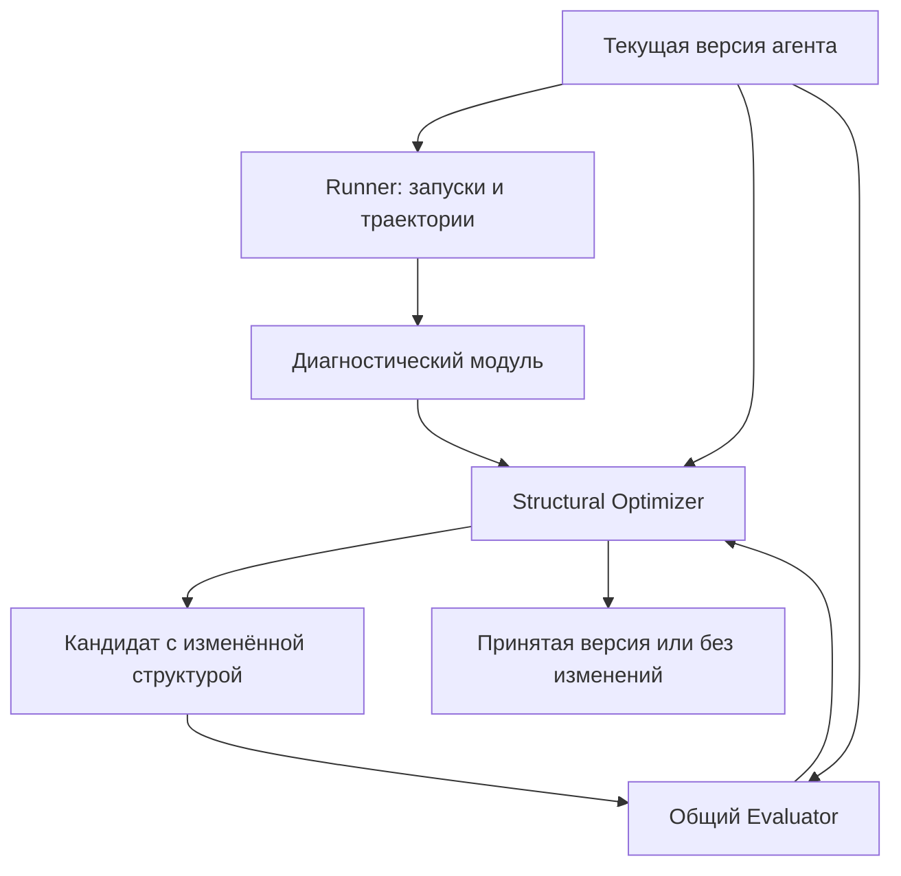
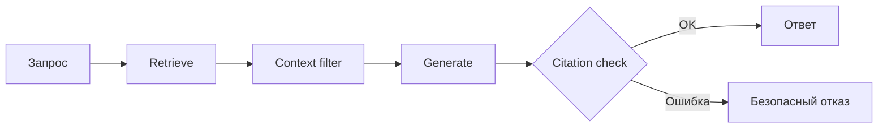
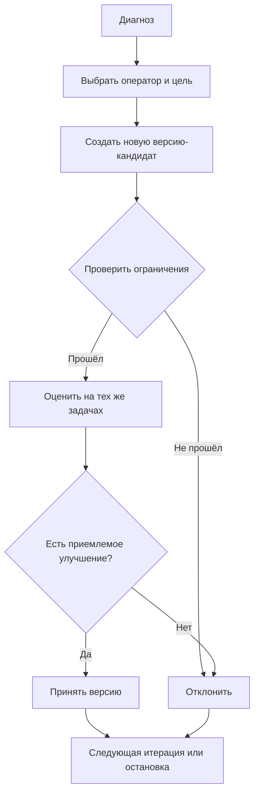

# Структурный оптимизатор агента (L2)

## 1. Назначение и границы ответственности

Модуль **Structural Optimizer** получает результаты диагностики работы агента и пытается устранить обнаруженные проблемы, **изменяя структуру выполнения и обвязку**, а не тексты промптов.

**В L2 разрешено:** подключать уже реализованные компоненты, менять связи между ними и управлять правилами выполнения (контекст, память, проверки, retry, fallback, маршрутизация).

**В L2 запрещено:**
- изменять промпты и текстовые описания инструментов — это L1;
- генерировать или редактировать произвольный Python-код, создавать новые реализации узлов и инструментов — это L3;
- изменять оценщик, тестовые задачи, эталонные ответы или исходный корпус документов.

**Принцип:** оптимизатор выбирает изменение из **заранее определённого каталога операций**. Он не придумывает, как программно реализовать это изменение. Код каждого допустимого преобразования существует заранее и контролируется системой.

Изменение обычных параметров модели или retriever (например, `temperature` или `top_k`) само по себе **не является основной задачей L2**. Параметры политик выполнения допустимы, когда они управляют структурным механизмом (например, числом попыток retry или лимитом контекста).

## 2. Что получает модуль и что возвращает

Для работы модуль использует текущую версию агента, диагностические отчёты, доступные структурные операции, набор задач, целевые метрики и ограничения поиска. Результат — лучшая принятая версия либо исходная версия, если улучшений не найдено; вместе с ней сохраняются diff, проверки и история попыток.

**Минимальные контракты между модулями:**

| Сущность | Необходимые поля |
|---|---|
| `DiagnosisReport` *(внешний)* | Тип ошибки, затронутый узел/шаг, evidence/ссылки на trace |
| `AgentStructure` | Узлы, переходы, политики, capabilities, immutable refs |
| `ChangeProposal` | Версия-родитель, ID оператора, целевой узел/связь, параметры, ID диагноза |
| `OptimizationRequest` | Версия агента, диагнозы, разрешённые операции, метрика, датасет, бюджет и условие остановки |
| `OptimizationResult` | Принятая версия или `NO_CHANGE`, история кандидатов, diff, сравнение метрик и причины решений |

## 3. Общая архитектура

*Рисунок 1. Место структурного оптимизатора в общем цикле.*

L2 использует **общие** Runner, Trace Collector, Diagnosis и Evaluator. Их повторно разрабатывать внутри модуля не нужно. Выбор между L1/L2/L3 в режиме `auto` выполняет **внешний оркестратор**, а не Structural Optimizer.

Внешний оркестратор отвечает за запуск общего эксперимента и итоговое применение принятой версии. L2 создаёт и проверяет структурные предложения, использует согласованные правила сравнения и передаёт результаты; отдельную альтернативную политику принятия вводить не нужно.

## 4. Представление структуры агента

Для структурных изменений необходимо **редактируемое представление агента** (`AgentStructure`):

| Часть | Что хранит |
|---|---|
| `nodes` | Идентификаторы узлов и ссылки на зарегистрированные реализации (`retrieve`, `generate`, `verify` и т. д.) |
| `edges` | Последовательность и допустимые условные переходы между узлами |
| `policies` | Настройки контекста, памяти, retry и fallback |
| `capabilities` | Какие изменения поддерживает конкретный агент |
| `immutable_refs` | Ссылки/хэши неизменяемых в L2 промптов, моделей и контрактов инструментов |

Это **не требование написать универсальный движок агентов**. Для MVP нужен `AgentAdapter` к одному выбранному RAG-агенту. Адаптер должен уметь:

1. Получить его текущую редактируемую структуру и список доступных компонентов.
2. Собрать **отдельную исполняемую версию** агента из допустимо изменённой структуры.
3. Сообщить, поддерживается ли конкретная операция (например, есть ли запасной retriever или hook для проверки ответа).

Если агент не предоставляет нужную точку расширения, соответствующий оператор для него **недоступен**. Произвольный Python-код агента автоматически разбирать и переписывать не требуется.

## 5. Каталог разрешённых преобразований

Каждый оператор имеет **ID, допустимую цель, параметры, предусловия и проверку результата**. Операция может использовать только зарегистрированные компоненты и разрешённые параметры.

| Оператор | Что может менять | Предусловие |
|---|---|---|
| `CONTEXT` | Подключить или перенастроить существующий отбор, очистку от дублей, упорядочивание и ограничение фрагментов контекста | Есть context-processing компонент / hook |
| `MEMORY` | Подключить, отключить или изменить расположение существующей памяти и политику чтения/записи | Есть совместимый компонент памяти; состояние изолируется между тестами |
| `VALIDATE` | Вставить существующую проверку аргументов, найденных источников или ответа | Проверка зарегистрирована, определено действие при неуспехе |
| `RETRY` | Обернуть вызов ограниченным числом повторных попыток при временном сбое | Вызов безопасен для повтора, установлен лимит попыток |
| `FALLBACK` | Добавить условный переход к существующему резервному компоненту | Альтернативный компонент зарегистрирован и совместим |
| `ROUTE` | Изменить порядок или условия переходов между существующими узлами | Совместимы входы/выходы; граф остаётся исполнимым |

**Пример изменения структуры** (не обязательный итоговый граф):

В этом примере `Context filter` и `Citation check` — **уже реализованные** компоненты, которые L2 может подключить к базовому `Retrieve → Generate`.

Для MVP **один кандидат = одна структурная операция**. После проверки отдельные успешные изменения могут применяться последовательно к текущей версии. Это позволяет не смешивать эффекты нескольких правок. Комбинации нескольких операций в одном кандидате — дальнейшее расширение.

## 6. Выбор операции по диагностике

Диагностический модуль передаёт **предполагаемую причину**, проблемный компонент/шаг и подтверждающие события траектории. Optimizer сопоставляет их с допустимыми операциями:

| Проблема по диагностике | Какие операторы рассматривать |
|---|---|
| Релевантные документы найдены, но потерялись или вытеснились из контекста | `CONTEXT` |
| Агент использует устаревшее или чужое состояние памяти | `MEMORY` |
| Ответ содержит неподтверждённые утверждения или некорректные ссылки | `VALIDATE` |
| Инструмент временно недоступен (timeout, rate limit) | `RETRY`, `FALLBACK` |
| Основной поиск вернул пустой результат при наличии альтернативы | `FALLBACK` |
| Неверный порядок шагов или выбор существующей ветки | `ROUTE` |
| Ошибка связана с промптом, отсутствующим документом или необходимостью нового инструмента | **Не исправлять в L2**; вернуть причину отказа |

**Логика выбора для MVP:**
1. Отфильтровать операции по типу ошибки и доступным `capabilities` агента.
2. Отсеять запрещённые и ранее безуспешно испробованные для этой версии изменения.
3. Приоритизировать проблемы по частоте/влиянию, а кандидатов — по ожидаемой полезности, стоимости и риску.
4. Выбрать конкретную цель и допустимые параметры оператора.

Начальная реализация — **правила + простое ранжирование**, без обязательного LLM-планировщика или MCTS. В дальнейшем LLM может **предлагать только оператор и его параметры**; применение изменений остаётся детерминированным.

Диагноз — гипотеза. Если нет применимой операции или достаточных оснований для изменения, допустим результат `NO_CHANGE`.

## 7. Как проходит итерация оптимизации

**Перед запуском кандидата проверяются:**
- операция и её параметры разрешены для выбранного агента;
- все узлы и переходы корректны, нет недостижимого выхода или неограниченных циклов;
- промпты, модели, описания инструментов и оценщик не изменены;
- retry/fallback не нарушают лимиты вызовов, времени и стоимости;
- исходная версия не перезаписывается.

**Оценка:** внешний Evaluator запускает исходную и изменённую версии на сопоставимых задачах. Решение принимается по заранее выбранной пользовательской метрике **с контролем регрессий, стоимости и задержки**. Плохая или неубедительная правка отклоняется. Рост одной вспомогательной метрики (например, доли ответов с ссылками) не должен автоматически считаться успехом, если ухудшилась полезность ответов.

**Разделение данных:** задачи для диагностики/поиска изменений (`repair`), проверки кандидатов (`validation`) и итоговой оценки (`test`) должны быть разными. Итоговый `test` недоступен оптимизатору; иначе поиск переобучится на тестовых вопросах.

**Версии:** каждый кандидат сохраняется отдельно от родителя. Фиксируются структурный diff, связанный диагноз, метрики и причина `ACCEPT`/`REJECT`. Откат — возврат к предыдущей сохранённой версии, без изменения исходного кода.

**Остановка:** по числу итераций, числу принятых изменений, отсутствию прироста качества либо исчерпанию бюджета. Эти условия задаются извне и могут комбинироваться.

## 8. Подробное описание компонентов

### 8.1. AgentAdapter

**Ответственность.** Получает редактируемую `AgentStructure` конкретного агента, объявляет его `capabilities` и собирает исполняемого кандидата из разрешённых компонентов.

**Входы.** Версия агента, изменённая структура. **Выходы.** Описание структуры и отдельная версия-кандидат. **Ограничение.** Без подходящего hook операция недоступна.

### 8.2. OperatorRegistry

**Ответственность.** Хранит каталог `CONTEXT`, `MEMORY`, `VALIDATE`, `RETRY`, `FALLBACK`, `ROUTE`, их параметры, предусловия и допустимые цели.

**Входы.** Каталог и `capabilities` агента. **Выходы.** Список разрешённых операций. **Ограничение.** Неизвестная операция отклоняется.

### 8.3. ChangeSelector

**Ответственность.** Сопоставляет `DiagnosisReport` с операциями, исключает недоступные варианты и ранжирует оставшиеся по частоте ошибки, ожидаемой пользе, стоимости и риску.

**Входы.** Диагнозы, каталог, история попыток. **Выходы.** `ChangeProposal` или `NO_CHANGE`.

### 8.4. StructureEditor

**Ответственность.** Применяет одну выбранную операцию к копии `AgentStructure` без произвольного редактирования исходного кода.

**Входы.** `ChangeProposal`, родительская структура. **Выходы.** Структурный кандидат и diff.

### 8.5. StructureValidator

**Ответственность.** Проверяет совместимость компонентов, корректность переходов, неизменяемые части и бюджетные ограничения до запуска кандидата.

**Входы.** Кандидат, допустимые операции и ограничения. **Выходы.** Результат проверки с причинами отклонения.

### 8.6. OptimizationLoop

**Ответственность.** Управляет локальными итерациями L2: выбор предложения, создание кандидата, запрос оценки и применение общих условий остановки.

**Входы.** `OptimizationRequest`. **Выходы.** `OptimizationResult`. **Ограничение.** Использует общие Runner, Evaluator и правила принятия; итоговая смена активной версии согласуется с оркестратором.

### 8.7. VersionStore

**Ответственность.** Предоставляет L2 доступ к версиям, diff, результатам и откату через **общее хранилище экспериментов**.

**Входы.** Кандидаты, оценки, решения. **Выходы.** Ссылки на версии и историю попыток. **Ограничение.** Не создаёт независимую систему хранения.

## 9. Технологии

| Часть | Рабочее решение | Назначение |
| --- | --- | --- |
| Язык | Python | Основной модуль и адаптер к целевому агенту |
| Схемы `AgentStructure` и `ChangeProposal` | Pydantic (рекомендуется) | Проверка параметров и контрактов |
| Каталог операторов | Реестр заранее реализованных преобразований | Ограничение пространства изменений L2 |
| Хранение версий и отчётов | Общее хранилище оболочки | История, diff и откат без отдельной БД |
| Запуск и оценка | Общие Runner и Evaluator | Сопоставимая проверка кандидатов |
| Тестирование | pytest (рекомендуется) | Проверка разрешённых операций и запретов |

Наличие LangGraph **не является обязательным условием** для L2: фактические способы подключения компонентов определяются адаптером выбранного агента. Конкретный формат конфигурации и API согласуются при интеграции.

## 10. Тестовая стратегия

| Проверка | Ожидаемое поведение |
| --- | --- |
| Разрешённый оператор с подходящим hook | Создаётся структурный кандидат, оригинал не изменяется |
| Несуществующий компонент или запрещённая операция | Отказ до запуска модели |
| `RETRY` / `FALLBACK` | Ограничения попыток, времени и стоимости соблюдаются |
| Некорректный переход `ROUTE` | Кандидат не проходит валидацию |
| Диагноз без применимого оператора | Возвращается `NO_CHANGE` |
| Кандидат с регрессией | Не становится активной версией; причина сохранена |
| Повторная оптимизация | История версий и возможность отката сохраняются |

## 11. Порядок реализации и критерии готовности MVP

До чекпоинта **15 марта 2027 года** нужно проверить поддержку операций на выбранном агенте, реализовать применимые преобразования и обеспечить интеграцию с общими Runner, Evaluator и оркестратором.

- [ ] Есть адаптер для **одного** выбранного базового агента, позволяющий собрать новую исполняемую версию без свободного редактирования кода.
- [ ] Определён и протестирован каталог ограниченных операций для контекста, памяти, проверок, retry, fallback и маршрутизации — в пределах возможностей выбранного агента.
- [ ] Диагностика автоматически приводит к выбору допустимого оператора или обоснованному `NO_CHANGE`.
- [ ] Работает полный цикл **изменение → валидация → оценка → принятие/отклонение**.
- [ ] Изменения не затрагивают промпты, чужие компоненты и оценщик; неуспешные кандидаты не меняют текущую версию.
- [ ] Доступны история версий, сравнение метрик и откат.
- [ ] Поддерживаются ограничения поиска и три требуемых варианта остановки: итерации, успешные изменения, динамика метрик.
- [ ] Модуль вызывается внешним оркестратором в режиме `structural`; режим `auto` может выбрать L2 через общий интерфейс.

## 12. Зависимости и принятые допущения

- **Базовый агент выбран (MADQA BM25 MLLM Agent):** состав доступных операторов определяется его реальными компонентами и точками расширения. Поддержку конкретных операций нужно проверить при создании `AgentAdapter`; при отсутствии hook оператор недоступен.
- **Диагностика и Evaluator — внешние модули:** согласуются форматы отчётов, запуска и метрик, но их внутренние алгоритмы не входят в данную подзадачу.
- **Текстовая память:** L2 управляет подключением и политикой использования существующей памяти, но не генерирует новые свободные инструкции/правила в её содержимом.
- **Исследовательские усложнения** (MCTS, генерация новых операторов, совместная оптимизация с L1, универсальная поддержка сторонних агентов) **не входят в MVP**.

## 13. Исследовательская опора архитектуры

- [Maestro](https://arxiv.org/abs/2509.04642) — ограниченное изменение графа и конфигурации агента.
- [Beyond Prompts / PRISM](https://arxiv.org/html/2609.05736v2) — выбор поверхности исправления по характеру ошибок.
- [ACE](https://arxiv.org/abs/2510.04618) — отдельная управляемая подсистема контекста и памяти.
- [RuleChef](https://arxiv.org/abs/2607.01293) — ограниченные проверяемые правила.
- [AFlow](https://github.com/FoundationAgents/AFlow) — организация итеративного поиска по workflow; **его свободная генерация кода в L2 не переносится**.
